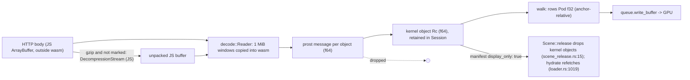

# Session Viewer — file format inventory (Phase 8)

Scope: `session/session_viewer` at the current checkout. Read-only audit: nothing was built or run. Sizes and copy counts come from reading the code and the schemas in `../session_proto/*.proto`; the one size comparison in §4 is `stat` on two existing files. Nothing here is a measured load time or memory peak.

Data structures behind these formats (row tables, `Scene`, `FileDoc`) are covered by [ARCHITECTURE.md §5](ARCHITECTURE.md#5-ownership); this file covers only what is read and written.

## 0. Verdict

The viewer reads one geometry format: the **session protobuf** (`.pb`, schema `../session_proto/session.proto`), whole, gzip-encoded or range-streamed. It writes one editable format: the **`.session` archive** (protobuf documents plus JSON metadata). Everything else is a manifest, a presentation asset, a diagnostic or a native-only test image. **OBJ, PLY, glTF, GLB, STL, STEP, XYZ and PDF are not read or written by the viewer.** The kernels already carry OBJ, STEP, XYZ, JSON and PDF code (§3), and that is where outside formats become `.pb` today.

## 1. Formats the viewer reads or writes

| Format | Status | Dir | Entry (file:line) | Geometry | Attributes / materials | Precision | Limits | CPU copies during decode |
|---|---|---|---|---|---|---|---|---|
| Scene manifest `.yaml` (JSON accepted as YAML; TOML behind feature `toml-manifests`, off in the page build) | Implemented | R | `app/manifest.rs:79-110` `Manifest::parse`; fetched `app/loader.rs:286-334` | none: `items[{file, name, at, xform, point_size, display_only, size, encoding}]`, `texts[]`, `live`, `view`, `grid` (`manifest.rs:4-58`) | world texts (`TextItem`: text, at, right, up, height, plate, color RGBA8) | f64 placements | 4 MiB, 100,000 items, non-empty `file` | JS buffer → `Uint8Array::to_vec` (`loader.rs:268,316`) → serde tree |
| Session protobuf `.pb`, whole file | Implemented | R | `app/decode.rs:232` `session_from_body`; called `loader.rs:453`, hydrate `loader.rs:1023`, native `selftest.rs:193` | `Objects` fields 3-9, 12-16, 18: Point, Line, Plane, BoundingBox, Polyline, PointCloud, Mesh, NurbsCurve, NurbsSurface, BRep, Element, Component (a kernel Matrix among them), InstanceRef; plus `tree`, `graph`, `xforms`, `definitions`, `interactions` (`decode.rs:255-340`). `Objects.sheets` (17) and `bvh_boxes` (6) are skipped here. | per-object colours (`Color` 4×f32), mesh packed `pointcolors_rgba`/`facecolors_rgba`/`linecolors_rgba` (f32), widths, dashes, arrowheads, `is_visible`/`is_locked`; mesh vertex/face/edge `map<string,double>` attributes. **No material, texture, UV or explicit normal field** in any schema (`mesh.proto`, `brep.proto`). | f64 everywhere in the file (`point.proto`, `mesh.proto:6-9`, `xform.proto`); f32 on the GPU after the walk (anchor-rebased, ARCHITECTURE §5) | 512 MiB whole-file (`decode.rs:32`), 2,000,000 objects, tree depth 64 (`validate.rs:5-14`), per-kind validation (`validate.rs:319-660`), scene byte budget `?budget=` (`loader.rs:672`) | (1) body stays a JS `ArrayBuffer` (`fetch.rs:340`); (2) 1 MiB windows copied into wasm (`decode.rs:24-26`), grown for a larger object and freed after it (`decode.rs:160-170`); (3) per object a prost struct then `from_proto` kernel object, the prost struct dropped (`decode.rs:202-224`); (4) tables reserved up front so nothing doubles (`decode.rs:437`); (5) retained kernel `Session` (f64) + walked rows (f32) |
| `.pb` gzip | Implemented | R | manifest `encoding: gzip` + `size` (`manifest.rs:19-21,61-64`); `loader.rs:420-434`: an encoded file is never range-read; if the host did not mark `Content-Encoding`, gzip magic triggers `DecompressionStream` (`loader.rs:620-636`, `fetch.rs:302-312`) | as `.pb` | as `.pb` | as `.pb` | as `.pb`; publisher gzips only payloads ≤ 32 MiB (`../bash/view_live.sh:40-47`) | +1 JS buffer for the unpacked body; nothing extra in wasm |
| Streamed point cloud `.pb` | Implemented | R | `loader.rs:709-883` `start_cloud`/`stream_prefix`/`stream_rest`; layout `app/stream.rs:1-16,279-300` | a single-`PointCloud` file is streamed when it has > 2,000,000 points or `coords` ≥ 64 MiB (`loader.rs:19-31,750`); octree from `lod_*` fields (`pointcloud.proto:25-34`, written by `examples/add_lod.rs`) | colours as packed `uint32` varints, one per channel (`pointcloud.proto:12`, `stream.rs:536`); normals packed doubles → octahedral u32 (`stream.rs:520`); `point_ids` fixed32 | file f64 → **f32 at parse** (`stream.rs:394-400`), non-finite refused | page budget 6,000,000 points `?points=` (`loader.rs:25,113`), 2,000,000 per slice; HTTP Range + ETag must match (`stream.rs:15`, `fetch.rs:175-197`) | range slice in JS → bytes → f32 rows; no kernel `PointCloud` retained (`scene.rs:1045-1056`) |
| Streamed sheet `.pb` (`Sheet`, field 17) + side table | Implemented | R | `loader.rs:886-1017`; `stream.rs:17-33`; table `app/sheet_query.rs:5-66` | 2D/3D segments: `coords` 6 doubles per segment (`sheet.proto:24`) | `colors` fixed32 RGBA8, `widths` f32 mm, `source_ids` fixed32 → side table: `SHM1` head, u32 count, 16-byte records (u64 offset, u64 length), JSON blob per entity ≤ 64 KiB (`sheet_query.rs:5-14,59-66`) | f64 file → f32 rows | 3,000,000 segments `?segments=` (`loader.rs:40,128`), 25,000 first slice | range slices; entity JSON fetched per click |
| Session JSON `.json` item | **Off in the page build** (feature `json-sessions`; ≈105 KB of wasm per the `Cargo.toml` `[features]` comment) | R | `decode.rs:680-705`; returns "JSON sessions are not read by this build" otherwise | same object model as `.pb` (kernel `Session::jsonload`) | same | f64 text | 512 MiB, depth 64 (`validate.rs:16-40`) | whole body to wasm (`array.to_vec()`), `serde_json::Value` for validation, a second `Value` in `jsonload` plus a `.clone()` of the `objects` subtree (`../session_rust/src/session.rs:2760-2770`), then the kernel session: up to four transient representations, no yielding |
| `.session` archive | Implemented | R/W | write `app/session_io.rs:140` `save`; read `:245` `open`; browser glue `:335-357` (`downloadSession`, `chooseSession`); `Save`/`Open` verbs | every retained document as an encoded `proto::Session` (with `is_visible`/`is_locked` stamped, `:58-136`) | `Metadata` JSON: document names and placements (16×f64), point size, hidden/locked/colour/edge-colour overrides (RGB8), texts, groups, current layer, `created_doc` (`:20-46`) | f64 | magic `SESSION-VIEWER\x01\n`, 512 MiB both ways; **save refuses streamed clouds, sheets and released documents** (`:141-150`) | save: `to_proto` tree per document → `encode_to_vec` per document → whole `Archive` encoded again behind the magic → JS `Blob` (≈3× file size + one proto tree). open: `arrayBuffer` → `to_vec` into wasm → `Archive::decode` copies each document → **each document decoded twice**, once to validate and dropped, then `Session::pb_loads` (`:304-308`) |
| Live manifest + revision | Implemented | R | `app/live.rs:217-423`, `app/live_revision.rs` | as manifest + `.pb` | – | – | poll ≥ 1 s | `fetch::get` copies the whole body into wasm (`fetch.rs:77`) before `session_from_bytes` (`live.rs:360`): unlike the main loader, a live reload holds the full file in wasm memory |
| Stage deck YAML + PNG pictures | Implemented | R | `app/stage/deck.rs:959,984`; PNG `app/stage/paint.rs:40-55` (`png` crate, expand, strip 16-bit → RGBA8) | slide decks, not scene geometry | – | – | – | PNG decoded to an RGBA8 `Vec` in wasm |
| Fonts `.ttf` / `.otf` | Implemented | R | embedded subsets `engine/text.rs:9-17` (`include_bytes!`); full fonts fetched `app/fonts.rs:43-47`; stage OTFs `app/stage/font.rs:14-17` | text | – | – | – | stage fonts leaked per `Font::new` (ARCHITECTURE §10.6) |
| Diagnostics report `.json` | Implemented | W | `Report` verb → `feedback.rs:237` → `assets/diagnostics.js:56-65` | none | events, phases, resources, adapter, canvas (report `version: 1`) | – | 3 reports kept in `localStorage` | – |
| `?inspect=1` JSON | Implemented (not a file) | W | `app/inspection.rs:7-158`, `ui/mod.rs:379-396` | selected geometry summary, bounds | – | f32 `mvp`, f64 camera | – | rebuilt each published frame |
| PPM `P6` | Implemented, **native only** | W | `src/selftest.rs:350-354` `write_ppm`; tests in `selftest/*`, `engine/gpu/clip/editing_tests.rs:1100`, `backdrop/application_tests.rs:107` | rendered frame | RGB8 | – | – | full frame readback |
| Python bridge (`session_py.viewer`) | Partial | W (Python) → R (viewer) | `../session_py/src/session_py/viewer.py:129` `serve` writes `net.pb` + `scene.yaml`; `:95` `_browser_url` puts the scene in `#session=<base64>` | as `.pb` | as `.pb` | f64 | – | no reader of `#session=` found in `src/` or `index.html` (UNVERIFIED path, see the feature part §3) |

Not present in the viewer: browser drag-and-drop or generic file import (`web-sys` features in `Cargo.toml` list no `File`, `FileReader`, `DragEvent` or `DataTransfer`; the only picker is the inline `chooseSession`, `accept='.session'`, `session_io.rs:344`), and screenshot export (no `toBlob`/`toDataURL`, no PNG encoder; browser captures come from Playwright `docs/capture_*.cjs`).

## 2. Load path and copies (whole `.pb`)

Doc drift found while tracing: `manifest.rs:17` says `display_only` is an "old flag, no longer changes anything", but `loader.rs:453,488-491` uses it: the decoder keeps only edge-named graph vertices, and the document's kernel objects are released after the walk.

## 3. Formats in the kernels (available, not wired to the viewer)

| Format | Kernel code | Geometry | Notes |
|---|---|---|---|
| OBJ | `../session_rust/src/file_obj.rs:10-166` (`write_file_obj_to_string`, `read_file_obj_from_str`, `read_file_obj_polylines`), same API in `../session_py/src/session_py/file_obj.py` | Mesh (`v`/`f` only, polygon faces), polylines (`curv`) | f64 text; ignores `vn`, `vt`, `usemtl`, groups; malformed lines skipped silently; a negative index below `-len` is not range-checked (`file_obj.rs:85`), so it needs hardening before any upload path. Used by the archived robot-arm example (`../archive/session_examples/robot_arm.*`, meshes in `../session_cpp/session_data/robot_arm/*.obj`). |
| STEP | `../session_rust/src/file_step.rs` (4,211 lines): read points, NURBS curves, surfaces, trimmed surfaces, BReps; write curves, surfaces, BReps | NURBS, BRep | file-path API (`std::fs`) |
| XYZ | `../session_rust/src/file_xyz.rs:9-61` | PointCloud positions | text f64, no colours |
| Session JSON | `../session_rust/src/session.rs:2755-2842`, `file_encoders.rs` | everything | what `json-sessions` would read |
| PDF → sheet | `../session_rust/src/pdf.rs`, bin `pdf_import` (`Cargo.toml:43-46`, feature `pdf`, native only, MuPDF) | `Sheet` segments | offline conversion to `.pb` |
| PLY, glTF, GLB, STL | none in `session_rust`, `session_py`, `session_cpp/src` (grep) | – | – |

## 4. Evaluation of candidate formats

Per-element sizes below are **computed from the schemas**, not measured. One existing pair was compared with `stat`: `../session_data/brep_demo.json` 203,678 B vs `../session_data/brep_demo.pb` 39,173 B (5.2×; same stem, content equality not verified).

| | JSON (session JSON) | Binary: session protobuf `.pb` | OBJ | PLY | glTF (`.gltf` + `.bin`) | GLB |
|---|---|---|---|---|---|---|
| In viewer today | reader behind `json-sessions`, off | **yes**: read whole, gzip, range-streamed; `.session` wraps it | no (kernel only) | no | no | no |
| Geometry | all session types | all session types incl. NURBS, BRep, elements, components, instances, sheets, LOD octree | polygon meshes, polylines | points, polygon meshes | triangle meshes, lines, points, node hierarchy, instancing (`EXT_mesh_gpu_instancing`) | same as glTF |
| Exact NURBS / BRep | yes | yes | no (tessellation only) | no | no | no |
| Attributes | all | colours, widths, dashes, arrowheads, visibility, lock, free `map<string,double>` per mesh vertex/face/edge, tree, graph, interactions | none besides positions in the kernel reader | arbitrary typed per-vertex/face properties (colour, normal, intensity) | normals, UV, colours, custom `_ATTR` | same |
| Materials / textures | none in the data model | none (colours only) | `.mtl` (not read) | none | PBR materials, textures | same, embedded |
| Precision | f64 decimal text | f64 (`double`), colours f32 | text, usually f64-printable | f32 or f64 per property | positions f32 only (needs a node offset for mm-scale world coordinates) | f32 |
| Mesh vertex size | 3 decimal numbers plus key names as text | `map<uint64, VertexData>` entry ≈ 31-35 B per vertex (entry header, key varint, 3 tagged doubles); faces as map entries of packed varints, plus a second `triangulation` map (`mesh.proto:33-50`) | ~30-40 B text | 12 B (f32 binary) | 12 B | 12 B |
| Cloud point size | text | 24 B coords + 4-8 B colours (one varint per channel) + 24 B normals | – | 15 B (xyz f32 + rgb u8) | 12-16 B | 12-16 B |
| Streaming / random access | no | yes, by field (cloud and sheet arrays are range-read) | no | header then fixed-stride binary body: range-readable | `.bin` buffers range-readable | single binary chunk, range-readable |
| CPU memory to load | highest: up to 4 transient trees (§1) | 1 MiB windows + one prost struct per object; kernel copy retained | full text + parsed arrays | one pass into typed arrays | JSON header + direct buffer views (zero-copy to GPU possible) | same |
| Round trip of the editable scene | yes | yes (`.session`) | no | no | no | no |
| Cost to add | flip a feature (+≈105 KB wasm) | none | kernel reader/writer exist; viewer needs file input + validation | new reader | new reader/writer + tessellation export | same |

## 5. Recommendation

1. **Keep the session protobuf as the only geometry format the viewer reads, and `.session` as its only editable save.** All three kernels write it; it is the only format that carries NURBS, BReps, elements, the tree, the graph and instances at f64, and the loader already streams it by field. No format in the brief replaces it without losing data.
2. **Do not add OBJ, PLY, glTF or GLB to the viewer now.** No file in the repository calls for any of them: the workspace OBJ, STEP and IFC files are converted offline by the kernels (the robot-arm example and `../compas_tf` data, which is consumed and never pushed), and no viewer issue, test or doc asks for an export to an outside tool. If the CLI/FastMCP `export geometry` operation (INTERFACE_INVENTORY §4) needs an outside-tool format, the first candidate is **OBJ through the existing kernel writer** (mesh only, no new parser). Revisit **GLB** only for a concrete "open this in another web or AR viewer" use case, because it is the only candidate with materials and f32 buffers ready for the GPU.
3. **Keep JSON off in the page build.** It costs ≈105 KB of wasm, decodes through up to four transient trees without yielding, and the one measured pair is 5.2× larger than its `.pb`. It stays useful as the kernels' test and diff format (`file_json_*`). The CLI and FastMCP layer uses JSON for **requests and replies**, not for bulk geometry. Geometry goes in as a `.pb` path or base64 `.pb`.
4. **Improve the binary format before adding another one** (proposals; each changes `../session_proto` and all three kernels, so each needs approval):
   - `Mesh`: packed `repeated double positions` and `repeated uint32 indices` instead of `map<uint64, VertexData>`/`map<uint64, FaceData>` (≈35 → 24 B per vertex at f64), and keep the `triangulation` map optional.
   - `PointCloud.colors`: packed `fixed32` RGBA8, as `Sheet.colors` already does (`sheet.proto:25`): 4 B per point, memcpy-decodable, instead of 4-8 B of varints that the streamer parses one by one.
5. **Small fixes in the existing paths** (evidence above, not yet measured): decode each `.session` document once (`session_io.rs:304-308`); let live reloads use the windowed `Body::Js` path rather than `fetch::get` → `to_vec` (`live.rs:420`, `fetch.rs:77`); correct the `display_only` comment (`manifest.rs:17`); bounds-check negative OBJ indices (`../session_rust/src/file_obj.rs:85`) before any OBJ upload path exists.
