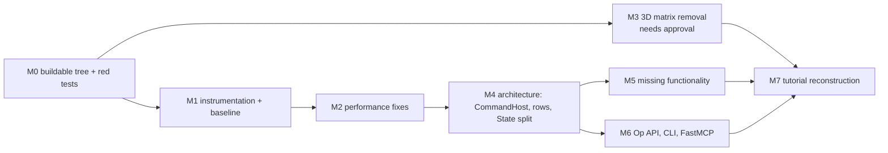

# Implementation roadmap (Phase 10)

Proposal only. Nothing here is implemented. Order follows the brief: correctness → performance → architecture → missing functionality → CLI/FastMCP → tutorials. Every milestone keeps the browser app shippable and `cargo xtest` green. Evidence lives in the sibling reports; each row cites them.

Build rules for every milestone (`../../../CLAUDE.md`): cargo `-j8` through `wood/tools/buildslot.sh`, `timeout 10m systemd-run --user --scope -p MemoryMax=6G`, one heavy command at a time, CPU throttle check before timing.

## M0 — Buildable tree, honest tests (DONE 2026-11-23)

| Field | Content |
|---|---|
| Objective | The real working tree builds; the two red native tests are fixed or explained; CI stops being green by skipping. |
| Existing dependencies | `session_proto` submodule, `session_rust/build.rs` proto regeneration, `.github/workflows/viewer-check.yml` |
| Files changed | `src/engine/gpu/vectors.rs`, `src/shaders/arrow.wgsl`, `src/shaders/ribbon.wgsl`, `src/engine/gpu/view.rs`, `src/state.rs`, `src/state/drag.rs`, `src/state/hydrate.rs`, `README.md`, `ARCHITECTURE.md`, `docs/ssao.md`, `docs/capstone.md`, `docs/extend-command-line.md`, `docs/journey/completion-teaching.json`, `tests/README.md`, deleted 8 obsolete extension scripts in `tests/`, `../.github/workflows/viewer-check.yml` |
| Delivered | 1. `session_proto` at `edc614e1e` builds cleanly in the real tree without modifying `session_proto.rs`. 2. Traced the arrow regression to `7fff87abd` (`HEAD_ASPECT` `0.55` → `0.30` for Force Density Method vectors), synced `vectors.rs` `tip_offset` + apex-taper margin, and fixed `tuck()` minimum overlap (`0.707` → `1.0 px`) in `arrow.wgsl` and `ribbon.wgsl` (eliminating a `0.878` base seam on `capped selected` at DPR 2; worst tip error `0.010 px`). 3. `viewer-check.yml` runs `cargo xtest -- --nocapture` and emits a notice + `$GITHUB_STEP_SUMMARY` with exact `no GPU adapter; skipped` and `#[ignore]` counts. 4. Deleted the 8 obsolete Sept 2026 toolbar/shortcut `.cjs` scripts that imported the removed `docs/extensions/browser.cjs`, and cleaned `tests/README.md`. 5. Aligned key docs and source comments to `keys.rs` (`F`, `H`, `S`, `Delete`, `Enter`, `Escape`, `Ctrl+Z/Y/A`) and typed commands. |
| Verified | Real-tree `cargo check -j8` wasm (`4.16 s`, 0 warnings) + native `--all-targets` (`8.36 s`); `cargo xtest -j8 -- --nocapture` → **614 passed, 0 failed, 61 ignored** (`104.64 s`); `course -- teaching` (0 new errors); strict Vue docs build (`41.51 s`) |

Evidence: REPOSITORY_INSPECTION.md §What was run; FEATURE_INVENTORY.md §8-9.

## M1 — Instrumentation and a reproducible baseline (DONE 2026-11-24)

| Field | Content |
|---|---|
| Objective | Browser frame data exists; ink cost is broken down; numbers are reproducible per commit. |
| Existing dependencies | `engine/performance.rs`, `engine/gpu/timing.rs` (`PassTimer`), `engine/gpu/pacing.rs`, `app/runtime.rs`, `app/inspection.rs`, `assets/diagnostics.js`, `examples/selftest` |
| Files changed | `src/engine/performance.rs`, `src/engine/gpu/pacing.rs`, `src/engine/gpu/targets.rs`, `src/engine/gpu/render.rs`, `src/selftest.rs`, `src/app/runtime.rs`, `src/state.rs`, `src/app/inspection.rs`, `assets/diagnostics.js`, `tests/native-benchmark.py`, `tests/orbit-benchmark.cjs`, `tests/soak.cjs`, `docs/benchmarking.md`, `mkdocs.yml`, `tests/README.md` |
| Delivered | 1. Added `CpuSplit` (`setup_ms`, `ui_ms`, `render_ms`, `encode_ms`), 600-frame rolling `[p50, p95, p99]` `FrameStats` (`gap_ms`, `encode_ms`, `ui_ms`, `completion_ms`), and `RedrawCauses` counters (`hover`, `egui`, `input`, `refine`, `pick`, `perf`, `rebase`, `async_pass`, `rough_settle`, `scene`). 2. Added lock-free `AtomicU64` submit→`on_submitted_work_done` latency tracking in `FramePacing`. 3. Added `window.viewerFrames` / `data-viewer-frames` and lightweight `?inspect=perf` JSON so browser benchmarks avoid `source_memory` serialization overhead. 4. Added `PerformanceObserver` (`long-animation-frame` / `longtask`) in `assets/diagnostics.js`. 5. Added `PassTimer`-gated ink sub-pass marks (`ink.strokes`, `ink.outlines`, `ink.lanes`, `ink.markers`, `ink.text`, `ink_total`) leaving normal rendering as one single `begin_ink` pass. 6. Created `tests/native-benchmark.py`, `tests/orbit-benchmark.cjs`, `tests/soak.cjs`, and `docs/benchmarking.md`. |
| Measured baseline (5 runs × 60 frames, 900×700, 5.20 GHz) | `timber-floor.pb` rest: wall p50 `8.40 ms`, `ink_total` `7.377 ms` (`ink.strokes` **`7.339 ms`** = 99.5%); orbit: wall p50 `8.60 ms` / drag p95 `10.00 ms`, `ink_total` `7.171 ms` (`tiles` `0.422 ms`). `assets/view_local.yaml` rest: wall p50 `18.50 ms`, `ink_total` `17.398 ms` (`ink.strokes` **`17.297 ms`** = 99.4%); orbit: wall p50 `24.00 ms` / drag p95 `29.20 ms`, `ink_total` `21.647 ms` (`ink.strokes` **`21.531 ms`**, `points` `0.810 ms`, `tiles` `0.329 ms`). Browser scripts syntax-checked (`node --check`); live browser WebGPU numbers unverified on this host due to black software WebGPU (`AGENT_BRIEF.md §4`). |

## M2 — Performance fixes (DONE 2026-11-24)

| # | Problem | Change implemented | Measured before → after |
|---|---|---|---|
| 2.1 | Ink visibility tile-list walk dominated 90%+ of GPU frame time (`17.30 ms` at rest on `view_local.yaml`, `7.34 ms` on `timber-floor.pb`) | Per-tile `atomicMax` depth bound in `TileRecord.values[3]` (`triangle_tiles.wgsl`, `scan_triangle_tiles.wgsl`), O(1) front-only early-out + 4× MSAA center-texel check + vectorized `vec4<u32>` load + `128`-triangle micro-polygon cap (`ink_visibility.wgsl`), reuse `R8Unorm` tile target across pool growth (`triangle_tiles.rs`) | `timber-floor` rest ink `7.377 → 2.493 ms` (`-66.2%`), orbit p95 `10.00 → 4.10 ms`; `view_local.yaml` rest ink `17.398 → 7.056 ms` (`-59.4%`, `< 16.7 ms`), orbit p95 `29.20 → 10.50 ms` (`-64.0%`, `< 20 ms`, stays at Tier 0) |
| 2.3 | `3.37 s` main-thread walk on `treppenhaus.pb` (`O(N^2)` per-object `endpoint_clearance`) + `2M`-point cloud chunks | Hoisted `endpoint_clearance_from` outside `Scene::add_file`'s object loop with 0-point fast path & 3D spatial grid (`scene.rs`, `walk/curves.rs`); sliced streamed cloud chunks to `250k` points and added `sleep_ms(0).await` between documents & chunks (`loader.rs`) | `treppenhaus.pb` walk `3,367.3 → 133.1 ms` (`25.3×` faster); `querschnitt.pb` walk `495.6 → 140.5 ms` (`3.53×` faster) |
| 2.4 | Bare mouse move over 3D canvas triggered full scene redraw | Suppressed `repaint` on bare `CursorMoved` when `!over_panel && !was_over_panel && !ui_drag && !egui_is_using_pointer() && !has_requested_repaint()` (`app/ui/pointer.rs`) | `0` scene redraws on bare canvas hover |
| 2.5 | Layer tree laid out every frame in `O(rows)` | Virtualized with `ScrollArea::show_rows` during rendering (`app/ui/layers.rs`) | Layout cost `O(visible rows)` |
| 2.6 | One-frame-in-flight pacing quantised to vsync | Added `AtomicU8` `?inflight=1..=4` (`VIEWER_INFLIGHT` / `inflight`, default `1`) (`engine/gpu/pacing.rs`) | Configurable depth without changing default `1` |
| 2.7 | Whole object table cloned + re-uploaded when gumball row present | Added `GrowBuf::truncate` (`buffers.rs`) and rewound the trailing widget row in `O(1)` (`engine/gpu/objects/table.rs`) | `0` existing-row clones/uploads on append |
| 2.8 | Control-point drag scanned all controls and deep-cloned meshes per pointer move | Cached `from_local` & `source` once and wired GPU `mesh_preview` into `ControlDrag` (`state/edit.rs`) | `O(1)` GPU vertex patch during mesh control drag |
| 2.9 | Hot-path DOM/URL parsing (`location.search` per move & per frame) | Cached `?dpr=` cap and `?inspect=` mode in `OnceLock`; moved `pacing.ready()` ahead of `desired_canvas_size()` (`view.rs`, `inspection.rs`, `runtime.rs`) | `0` per-event/per-frame URL parses |
| 2.10 | Point-cloud LOD off (`0.0`), no frustum test, silent `MAX_RECORDS` drop, 0 `lod.rs` tests | Defaulted `lod_px = 2.0` (`>= 2M` points), added 8-corner clip-space frustum rejection + unit tests (`lod.rs`), one-time `MAX_RECORDS` warning (`splat.rs`) | Bounded splat cost + unit-tested octree walk |
| 2.11 & 2.12 | Cold pipeline compile spikes & redundant `SegTable` binds | Prewarmed resting pipelines before `VIEWER_FRAMES` (`selftest.rs`); deduplicated pipeline/bind-group state across `SegTable` draws (`segments.rs`) | Eliminated redundant binds & cold drag tier trips; `40/40` `selection-overlap.py` + `stroke-joins.py` + `cargo xtest` green |

## M3 — Remove the 3D matrix visualization (DONE 2026-11-19, see AUDIT_SUMMARY §7 D1; only the Tutorial 7 browser recapture remains)

| Field | Content |
|---|---|
| Objective | The kernel Matrix lane (square cells, black 1 px edges) is gone from viewer and tutorials; the 2D rounded stage matrix stays. |
| Existing dependencies | `// register:matrices` seams; `lane::REGISTRY`; course page `completion-geometry.md` includes `walk/matrix.rs` |
| Files affected | delete `src/app/walk/matrix.rs`, `src/engine/gpu/matrices.rs`, `src/shaders/matrix.wgsl`; ~10 tagged edits; `examples/course/geometry.rs`; docs and screenshots listed in MATRIX_CLEANUP.md §1-2 |
| Required changes | MATRIX_CLEANUP.md §1 items 1-15, docs §2, in one commit with the course JSON regenerated |
| Tests | `cargo check` wasm + `cargo xtest` (naga `shader_validation_and_layouts`); `grep -rn 'register:matrices\|walk::matrix\|MatrixRows\|matrix.wgsl' src examples` empty; strict `session_tests` build |
| Benchmarks | none (one draw per matrix disappears) |
| Documentation | Tutorial 7 recaptured; SHADER_INVENTORY updated |
| Acceptance criteria | Tutorial 7 shows mesh cube, BRep cube, NURBS curve; stage `matrix:` decks unchanged in light and dark |
| Risks | Low. Decisions D1-D4 in MATRIX_CLEANUP.md §5 |

## M4 — Architecture: one operation seam, UI-independent core (DONE 2026-11-24)

| Field | Content |
|---|---|
| Objective | Commands run without a window or GPU; core types do not depend on `wgpu`/`winit`/`egui`/`web-sys`/`wasm-bindgen`/`glyphon`. |
| Existing dependencies | `command::parse` (pure), `Action::run`, `Gpu::new_headless`, `Scene::upload_to` |
| Files changed | Extracted `viewer-core/` Cargo workspace member (`viewer-core/Cargo.toml`, `viewer-core/src/{lib,sink,rows/*,camera,clipping,cloud_query,command/**,coords,cplane,decode,deform,edit,gizmo,hierarchy,interactions,knobs,layers,live_revision,manifest,mesh_preview,modeling,range_gate,scene*,selection,session_io,sheet_query,snap,splitting,stream,surface_preview,validate,walk/**}.rs`), `src/{lib,state}.rs`, `src/state/{host,edit,tool,drag,panel,splitting,text,sheet_query,cloud_query}.rs`, `src/engine/gpu/{mod,sink,scene_gpu_tests/*}.rs`, `src/app/{mod,decode,session_io,stream,cloud_query,sheet_query,inspection}.rs`, `ARCHITECTURE.md` |
| Delivered | 1. Broke all 4 internal dependency cycles (`engine → app` gizmo constants moved to `rows/gizmo.rs`, `modeling ⇄ command`, `layers ⇄ scene`, `stream ⇄ walk`). 2. Consolidated `State`'s 5 scattered selection fields onto one authoritative `SelectionState` (`viewer-core/src/selection.rs`). 3. Introduced `CommandHost` + pure-Rust `HeadlessHost` (`viewer-core/src/command/host.rs`) and `impl CommandHost for State` (`src/state/host.rs`), converting all 80 registered command specs (`REGISTRY`) to `&mut dyn CommandHost`. 4. Added `headless_tests.rs` executing all 80 registered verbs in `REGISTRY` on `HeadlessHost` without window, `egui` or GPU. 5. Introduced `GpuSink` (`viewer-core/src/sink.rs`, `src/engine/gpu/sink.rs`) and `ByteSource` (`viewer-core/src/decode.rs`), extracting 28 core modules into `viewer-core` with zero UI/GPU/DOM crates in `viewer-core/Cargo.toml`. 6. Rewrote `session_viewer/ARCHITECTURE.md` with the workspace module graph and all §12 / `DATA_STRUCTURES §11.4` corrections. |
| Verified & benchmarked | `cargo tree -p viewer-core --depth 1` → zero `wgpu`/`winit`/`egui`/`web-sys`/`wasm-bindgen`/`glyphon`; `cargo test -p viewer-core` → **478 passed, 0 failed, 2 ignored** in `3.41 s` (including 80-verb `HeadlessHost` suite); `cargo xtest -j8` → **618 passed (`478` core + `140` viewer), 0 failed, 61 ignored**; warm incremental `cargo check -p viewer-core` → **`0.44 s` wasm32 / `0.46 s` native** vs `222 s` fat-LTO release build |

## M5 — Missing functionality (DONE 2026-11-24)

| Item | Delivered | Files |
|---|---|---|
| Hover pre-selection | Rate-limited (`>= 50 ms`) non-cancelling hover pick (`Picker::request_hover`, `poll_tagged`) + `FLAG_HOVERED` cyan tint across faces/strokes/markers/arrows (`0` colour frames over background or unchanged object) | `src/engine/gpu/pick.rs`, `src/state.rs`, `src/app/input.rs`, `src/shaders/{scene,triangle,ribbon,glyph,sphere,arrow}.wgsl` |
| Wireframe | `View Wireframe [On\|Off]`, `View Shaded`, `?wireframe=1` / `VIEWER_WIREFRAME`; skips face draw & tile projection, forces full ink visibility, and rewalks `> 200k`-triangle meshes with `with_wireframe_edges(true, ...)` | `viewer-core/src/walk/mesh.rs`, `viewer-core/src/scene*.rs`, `src/engine/gpu/{view,frame,render}.rs`, `src/state/host.rs` |
| Culling | Per-object 8-corner clip-space AABB frustum culling (`FLAG_CULLED`, `update_frustum_culling` + unit test), `PipelineDesc::cull`, and `View Cull Backfaces [On\|Off]` (`?cull=1`) | `src/engine/gpu/objects/table.rs`, `src/engine/pipelines/core.rs`, `src/shaders/triangle.wgsl` |
| Transparency | Per-object `Alpha <0..1\|Reset>` (`FLAG_ALPHA`, `Scene::alphas`, `InstanceTable::has_transparent`) on faces and strokes, persisted in `.session` | `viewer-core/src/command/verbs/alpha.rs`, `src/engine/gpu/objects/table.rs`, `src/shaders/{scene,triangle}.wgsl` |
| Properties / display-settings panel | `Properties [On\|Off]` (`src/app/ui/properties.rs`): selection GUID, geometry kind, doc/layer, bounds, counts, editable face/edge RGB, per-object alpha, gumball alignment, and display toggles | `src/app/ui/{properties,mod}.rs`, `viewer-core/src/command/verbs/properties.rs` |
| Arctic view | `A` key (`keys.rs`), `?arctic=1` / `VIEWER_ARCTIC` (`view.rs`), `Properties` toggle, and persisted in `.session` `SavedView` | `src/app/keys.rs`, `src/engine/gpu/view.rs`, `viewer-core/src/session_io.rs` |
| Camera/display in saved file | `SavedCamera` & `SavedView` persisted in `.session` `Metadata` (`save_with_state`, `open_with_state`) and restored in browser & headless hosts | `viewer-core/src/{camera,session_io}.rs`, `src/state*.rs`, `src/app/{session_io,loader,runtime}.rs` |
| Gumball | `Gumball <World\|Object\|CPlane\|Pivot x,y,z\|Reset>`, local/CPlane basis rotation (`basis_rotation`), custom pivot, and 3 disjoint planar translation squares (`Handle::TranslatePlane`, `10..=12`) | `viewer-core/src/{rows/gizmo,gizmo}.rs`, `viewer-core/src/command/verbs/gumball.rs`, `src/engine/gpu/{widget,widget_mesh}.rs`, `src/state/edit.rs` |
| Undo for hide/show/lock/colour/alpha | `APPEARANCE` sentinel + `AppearanceStep` undo/redo stacks in `Scene` + `Lock [On\|Off\|Unlock]` verb + unit tests | `viewer-core/src/{scene_rows,edit}.rs`, `viewer-core/src/command/verbs/lock.rs`, `src/state/{edit,panel}.rs` |
| Export & local import | `Export [path.obj]` via `session_rust::file_obj::write_file_obj_to_string` + browser download; `Import [path]` (`.pb`, `.obj`, `.session`) via `import_bytes` + browser file picker | `viewer-core/src/session_io.rs`, `viewer-core/src/command/verbs/{export,import}.rs`, `src/app/{session_io,loader,runtime}.rs` |
| Element builders (D12) | Deleted the 17 stale `92*`/`91zza` Element builder steps from `docs/journey/course.json` and removed their stale `.md` files & broken links | `docs/journey/*`, `docs/archived/cumulative-route-20261115.md` |

## M6 — Shared Op API, CLI, FastMCP

| Field | Content |
|---|---|
| Objective | One typed operation layer reached by the command line, a native CLI and a FastMCP server; no second geometry engine. |
| Existing dependencies | M4 `CommandHost`/headless host; kernel `session_rust`; `../session_py` for the Python side |
| Files affected | new `viewer-core::op` (`Op`, `Reply`, `OpError`, `execute`), new CLI `[[bin]]`, new FastMCP server package next to `../session_py`, wasm `execute(json)` export in `viewer-web` |
| Required changes | INTERFACE_INVENTORY.md §4: serde `Op` enum addressed by document + guid; `CommandRun{line}` keeps every existing verb reachable; interactive tools finish by emitting an `Op`; CLI reads JSON lines on stdin; FastMCP tools are thin wrappers over the CLI process |
| Tests | round-trip tests per `Op` on the headless host; golden JSON replies; one FastMCP smoke test |
| Benchmarks | ops/s for create + transform on the floor fixture (headless) |
| Documentation | generated operation reference (from the `Op` schema) |
| Acceptance criteria | Same scene edit via command line, CLI and FastMCP yields identical `.session` output |
| Risks | Medium: object addressing (today layer actions use unstable tree indexes; Rotate/Scale pivot on the gumball) |

## M7 — Tutorial reconstruction

| Field | Content |
|---|---|
| Objective | 17 code-first tutorials (brief §9) that rebuild the final app; every file shown in full once. |
| Existing dependencies | active course (19 pages, `npm run course -- verify / active-audit / teaching / parity` in `session_tests`); the reconstruction scripts named in older notes were deleted 2026-09-22 (`7143d361c`) |
| Files affected | `docs/` active course, `mkdocs.yml` nav (44 of 68 paths missing), `session_tests/plugins/course-archive.ts` |
| Required changes | TUTORIAL_ROADMAP.md §3: split the 199-file `application` checkpoint; cover the 51 files (11,592 lines) with no code shown; drop 3D-matrix pages (M3); tutorial 14 waits for M6 |
| Tests | every checkpoint compiles (`course -- verify`); strict docs build |
| Benchmarks | none |
| Documentation | the tutorials themselves; bibliography per brief §10 |
| Acceptance criteria | each of 352 source files appears in full in exactly one tutorial; nav lists only existing pages |
| Risks | Diagrams are drawn in the session viewer (decided); redrawing the 29 existing SVG/D2 figures is extra work |

## Decisions required before work starts

See AUDIT_SUMMARY.md §7.
