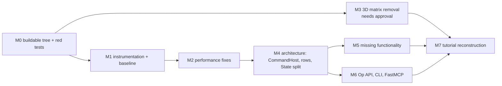

# Implementation roadmap (Phase 10)

Proposal only. Nothing here is implemented. Order follows the brief: correctness → performance → architecture → missing functionality → CLI/FastMCP → tutorials. Every milestone keeps the browser app shippable and `cargo xtest` green. Evidence lives in the sibling reports; each row cites them.

Build rules for every milestone (`../../../CLAUDE.md`): cargo `-j8` through `wood/tools/buildslot.sh`, `timeout 10m systemd-run --user --scope -p MemoryMax=6G`, one heavy command at a time, CPU throttle check before timing.

## M0 — Buildable tree, honest tests (DONE 2026-11-23)

| Field | Content |
|---|---|
| Objective | The real working tree builds; the two red native tests are fixed or explained; CI stops being green by skipping. |
| Existing dependencies | `session_proto` submodule, `session_rust/build.rs` proto regeneration, `.github/workflows/viewer-check.yml` |
| Files changed | `src/engine/gpu/vectors.rs`, `src/shaders/arrow.wgsl`, `src/shaders/ribbon.wgsl`, `src/engine/gpu/view.rs`, `src/state.rs`, `src/state/drag.rs`, `src/state/hydrate.rs`, `README.md`, `ARCHITECTURE.md`, `docs/ssao.md`, `docs/capstone.md`, `docs/extend-command-line.md`, `docs/journey/completion-teaching.json`, `tests/README.md`, deleted 8 obsolete extension scripts in `tests/`, `../.github/workflows/viewer-check.yml` |
| Delivered | 1. `session_proto` at `edc614e1e` builds cleanly in the real tree without modifying `session_proto.rs`. 2. Traced the arrow regression to `7fff87abd` (`HEAD_ASPECT` `0.55` → `0.30` for Force Density Method vectors), synced `vectors.rs` `tip_offset` + apex-taper margin, and fixed `tuck()` minimum overlap (`0.707` → `1.0 px`) in `arrow.wgsl` and `ribbon.wgsl` (eliminating a `0.878` base seam on `capped selected` at DPR 2; worst tip error `0.010 px`). 3. `viewer-check.yml` runs `cargo xtest -- --nocapture` and emits a notice + `$GITHUB_STEP_SUMMARY` with exact `no GPU adapter; skipped` and `#[ignore]` counts. 4. Deleted the 8 obsolete Sept 2026 toolbar/shortcut `.cjs` scripts that imported the removed `docs/extensions/browser.cjs`, and cleaned `tests/README.md`. 5. Aligned key docs and source comments to `keys.rs` (`F`, `H`, `S`, `Delete`, `Enter`, `Escape`, `Ctrl+Z/Y/A`) and typed commands. |
| Verified | Real-tree `cargo check -j8` wasm (`4.16 s`, 0 warnings) + native `--all-targets` (`8.36 s`); `cargo xtest -j8 -- --nocapture` → **614 passed, 0 failed, 61 ignored** (`104.64 s`); `course -- teaching` (0 new errors); strict Vue docs build (`41.51 s`) |

Evidence: REPOSITORY_INSPECTION.md §What was run; FEATURE_INVENTORY.md §8-9.

## M1 — Instrumentation and a reproducible baseline (performance, step 1)

| Field | Content |
|---|---|
| Objective | Browser frame data exists; ink cost is broken down; numbers are reproducible per commit. |
| Existing dependencies | `engine/performance.rs`, `engine/gpu/timing.rs` (`PassTimer`), `engine/gpu/pacing.rs`, `app/runtime.rs`, `app/inspection.rs`, `assets/diagnostics.js`, `examples/selftest` |
| Files affected | `runtime.rs`, `performance.rs`, `pacing.rs`, `state.rs:289-300,607,670`, `render.rs` (ink sub-marks), `segments.rs:647-675`, `assets/diagnostics.js`, new `tests/orbit-benchmark.cjs`, new `tests/soak.cjs` |
| Required changes | PERFORMANCE_AUDIT §5 I1-I8: CPU split per redraw, p50/p95/p99 ring, submit→completion latency, long-animation-frame observer, redraw-by-cause counters, cheap `window.viewerFrames` counter (tests stop timing `?inspect=1`), `PassTimer` marks inside the ink pass per sub-draw (ribbon / vector / glyph / text). |
| Tests | existing `navigation-pacing.cjs`, `visibility-idle.cjs` still pass |
| Benchmarks | `selftest` rows of PERFORMANCE_AUDIT §3.4 ×5 runs (median of medians); browser baseline D (§5.1): floor fixture + `view_local.yaml`, desktop 1200×800 and phone 412×915, 5 s orbit / hover / wheel |
| Documentation | PERFORMANCE_AUDIT §3 gains a browser table; a `docs/` page "how to benchmark" replaces hand recipes |
| Acceptance criteria | One command prints p50/p95 frame gap, completion latency, redraws by cause and ink sub-pass ms for both fixtures |
| Risks | Low; everything behind `?perf` / `?inspect` / env knobs |

## M2 — Performance fixes (ranked by evidence)

Order changes once M1 numbers exist. Measured items first.

| # | Problem | Evidence | Change | Files |
|---|---|---|---|---|
| 2.1 | Ink pass is ~90% of GPU time; 17.4 ms at rest on the 104 MB scene, MSAA only 9-22% of it | PERFORMANCE_AUDIT §3.4, H13 (measured), H14 | After M1 sub-marks: bound the visibility tile-list walk (cap length, coarser tiles in dense areas, front-only early out) | `shaders/ink_visibility.wgsl:386-418`, `engine/gpu/triangle_tiles.rs` |
| 2.3 | 3.3 s main-thread BRep walk on load (`treppenhaus`) | §3.4 (measured), H5 | Yield between documents/objects; slice cloud chunks to 250 k points | `state.rs:121-132`, `scene.rs:1155-1183`, `app/walk/brep*.rs` |
| 2.4 | Bare mouse move → full scene redraw | H1 (hypothesis) | `request_frame()` only when egui needs it or a button/wheel/key changed | `app/runtime.rs:460-462`, `app/ui/pointer.rs:86` |
| 2.5 | Layer tree laid out every frame, O(rows) | H2 | `ScrollArea::show_rows` | `app/ui/layers.rs:153-168` |
| 2.6 | One-frame-in-flight pacing quantises to vsync | H3 | `?inflight=2` experiment; default stays 1 until phone p95 agrees | `engine/gpu/pacing.rs` |
| 2.7 | Whole object table cloned + re-uploaded per `set_scene` with a gumball row | DATA_STRUCTURES §11.2 (verified by reading) | Patch the gumball row only | `engine/gpu/objects/table.rs:245` |
| 2.8 | Control-point drag deep-clones and re-walks the object per pointer move | DATA_STRUCTURES §8 | Clone once at drag start; commit one history entry at release | `app/deform.rs:165`, `state/drag.rs` |
| 2.9 | DOM/URL reads on the hot path (`desired_canvas_size` ×2, `location.search` per frame and per move) | H7, DATA_STRUCTURES §11.3 | Cache DPR/knobs in `Cell`/`OnceLock`, refresh on resize | `runtime.rs:215,225`, `view.rs:93-104`, `input.rs:129-188`, `state.rs:680` |
| 2.10 | Point clouds: LOD off by default, no frustum test, `MAX_RECORDS=4096` silently drops runs | H4, DATA_STRUCTURES §4 | Default `lod_px≈2` above `LOD_MIN_POINTS`, node frustum rejection, warn on cap | `view.rs:45`, `engine/gpu/lod.rs:46-54`, `splat.rs:431` |
| 2.11 | Pipelines compile on first use mid-frame; clip toggle recompiles all ink pipelines | SHADER_INVENTORY §5 | Prewarm after first present; specialise clipping without full recompile | `engine/pipelines/core.rs:425-460` |
| 2.12 | Redundant `set_pipeline`/bind calls; one draw per matrix; one draw per world label | SHADER_INVENTORY §5 | Skip unchanged state in `draw_table`; text atlas | `segments.rs:647-675`, `text_plane.rs:276-279` |
| 2.13 | Dead mask pipelines | SHADER_INVENTORY §4.3 | **Done 2026-11-19**: removed with the 4 compiler warnings | — |

| Field | Content |
|---|---|
| Tests | `cargo xtest`; `selftest` image diff per change (`docs/journey` native-render recipe: difference two frames); `navigation-pacing.cjs`, `visibility-idle.cjs`, `interaction.cjs` |
| Benchmarks | M1 harness before/after each row; record in PERFORMANCE_AUDIT |
| Documentation | Each fix appends a measured before/after row |
| Acceptance criteria | `view_local.yaml` at rest < 16.7 ms GPU on the RTX 4080; orbit p95 < 20 ms; floor load walk not blocking input > 50 ms; hover with no button produces 0 scene redraws |
| Risks | 2.1 hidden-line correctness; 2.2 is a design call; 2.6 latency regression on phones |

## M3 — Remove the 3D matrix visualization (DONE 2026-11-19, see AUDIT_SUMMARY §7 D1; only the Tutorial 7 browser recapture remains)

| Field | Content |
|---|---|
| Objective | The kernel Matrix lane (square cells, black 1 px edges) is gone from viewer and tutorials; the 2D rounded stage matrix stays. |
| Existing dependencies | `// register:matrices` seams; `lane::REGISTRY`; course page `completion-geometry.md` includes `walk/matrix.rs` |
| Files affected | delete `src/app/walk/matrix.rs`, `src/engine/gpu/matrices.rs`, `src/shaders/matrix.wgsl`; ~10 tagged edits; `examples/course/geometry.rs`; docs and screenshots listed in MATRIX_CLEANUP.md §1-2 |
| Required changes | MATRIX_CLEANUP.md §1 items 1-15, docs §2, in one commit with the course JSON regenerated |
| Tests | `cargo check` wasm + `cargo xtest` (naga `shader_validation_and_layouts`); `grep -rn 'register:matrices\|walk::matrix\|MatrixRows\|matrix.wgsl' src examples` empty; strict `session_tests` build |
| Benchmarks | none (one draw per matrix disappears) |
| Documentation | Tutorial 7 recaptured; SHADER_INVENTORY updated |
| Acceptance criteria | Tutorial 7 shows mesh cube, BRep cube, NURBS curve; stage `matrix:` decks unchanged in light and dark |
| Risks | Low. Decisions D1-D4 in MATRIX_CLEANUP.md §5 |

## M4 — Architecture: one operation seam, UI-independent core

| Field | Content |
|---|---|
| Objective | Commands run without a window or GPU; core types do not depend on `wgpu`/`egui`/`web-sys`. |
| Existing dependencies | `command::parse` (pure), `Action::run(&mut State)` (67 verbs), `Gpu::new_headless`, `Scene::upload_to(&mut Gpu)` |
| Files affected | ARCHITECTURE.md §11 steps 1-5: `app/gizmo.rs`, `app/modeling.rs`, `app/command/verbs/*`, `app/layers.rs`↔`scene.rs`, `app/stream.rs`↔`walk/`, `engine/gpu/{upload,objects,arena,segments,glyphs}` row types, `state.rs`, `state/features.rs` |
| Required changes | (1) break the cheap cycles; (2) `CommandHost` trait, verbs generic over it, headless host; (3) row types into a `rows` module; (4) split `State` into `Session` (core) + `Viewer` (web); `Scene::drain_changes()` replaces `&mut Gpu` calls; one authoritative selection (DATA_STRUCTURES §9.1: 9 copies today); (5) Cargo workspace with `viewer-core` |
| Tests | new native tests that run every verb on the headless host (none exist: `command/tests.rs` has no `run(`) |
| Benchmarks | incremental build time of `viewer-core` vs the 222 s fat-LTO release build |
| Documentation | Replace `../ARCHITECTURE.md` module graph; apply its corrections (ARCHITECTURE.md §12, DATA_STRUCTURES §11.4) |
| Acceptance criteria | `cargo test -p viewer-core` without `wgpu` in its dependency tree; 67 verbs covered by native tests; Playwright suite unchanged |
| Risks | High for step 4 (State split); do steps 1-3 first, each separately green |

## M5 — Missing functionality (from FEATURE_INVENTORY §9)

| Item | Current | Proposed scope | Files |
|---|---|---|---|
| Hover pre-selection | gizmo / snap / Trim-Extend only | object, edge and face hover highlight via the existing pick pass, rate-limited | `state.rs:703`, `engine/gpu/pick.rs` |
| Wireframe | x-ray only; meshes > 200 k triangles have no edges | explicit wireframe mode; edges for large meshes on demand | `app/walk/`, `render.rs` |
| Culling | none (back-face, frustum, object) | per-object frustum culling from bounds; back-face toggle for closed solids | `pipelines/core.rs:561`, scene bounds |
| Transparency | global alpha, unsorted, closed solids only | per-object alpha; sort or OIT only if a use case needs it | `render.rs`, `triangle.wgsl` |
| Properties / display-settings panel | missing | read-only properties first, then editable colour/layer | `app/ui/` |
| Arctic view | `Arctic On/Off` command only | key, `?arctic=1`, saved in `.session` metadata | `verbs/arctic.rs`, `keys.rs`, `session_io` |
| Camera/display in saved file | missing | add to `.session` `Metadata` | `app/session_io*` |
| Gumball | world axes only | pivot, planar handles, local frame | `app/gizmo.rs`, `state/edit.rs` |
| Undo for hide/show/lock/colour | not recorded | history entries | `app/edit.rs` |
| Export | none | OBJ export via the kernel writer (FILE_FORMATS.md recommendation); local `.pb` import from disk | `session_rust` OBJ writer, `app/loader.rs` |
| Element builders | removed 2026-11-05 (`66ff54224`) | decide: restore or delete course steps `92*` | docs |

Tests: one native test per item through the M4 headless host plus one Playwright case. Acceptance: FEATURE_INVENTORY §9 rows move to Implemented. Risk: scope creep; each item is its own approval.

## M6 — Shared Op API, CLI, FastMCP

| Field | Content |
|---|---|
| Objective | One typed operation layer reached by the command line, a native CLI and a FastMCP server; no second geometry engine. |
| Existing dependencies | M4 `CommandHost`/headless host; kernel `session_rust`; `../session_py` for the Python side |
| Files affected | new `viewer-core::op` (`Op`, `Reply`, `OpError`, `execute`), new CLI `[[bin]]`, new FastMCP server package next to `../session_py`, wasm `execute(json)` export in `viewer-web` |
| Required changes | INTERFACE_INVENTORY.md §4: serde `Op` enum addressed by document + guid; `CommandRun{line}` keeps every existing verb reachable; interactive tools finish by emitting an `Op`; CLI reads JSON lines on stdin; FastMCP tools are thin wrappers over the CLI process |
| Tests | round-trip tests per `Op` on the headless host; golden JSON replies; one FastMCP smoke test |
| Benchmarks | ops/s for create + transform on the floor fixture (headless) |
| Documentation | generated operation reference (from the `Op` schema) |
| Acceptance criteria | Same scene edit via command line, CLI and FastMCP yields identical `.session` output |
| Risks | Medium: object addressing (today layer actions use unstable tree indexes; Rotate/Scale pivot on the gumball) |

## M7 — Tutorial reconstruction

| Field | Content |
|---|---|
| Objective | 17 code-first tutorials (brief §9) that rebuild the final app; every file shown in full once. |
| Existing dependencies | active course (19 pages, `npm run course -- verify / active-audit / teaching / parity` in `session_tests`); the reconstruction scripts named in older notes were deleted 2026-09-22 (`7143d361c`) |
| Files affected | `docs/` active course, `mkdocs.yml` nav (44 of 68 paths missing), `session_tests/plugins/course-archive.ts` |
| Required changes | TUTORIAL_ROADMAP.md §3: split the 199-file `application` checkpoint; cover the 51 files (11,592 lines) with no code shown; drop 3D-matrix pages (M3); tutorial 14 waits for M6 |
| Tests | every checkpoint compiles (`course -- verify`); strict docs build |
| Benchmarks | none |
| Documentation | the tutorials themselves; bibliography per brief §10 |
| Acceptance criteria | each of 352 source files appears in full in exactly one tutorial; nav lists only existing pages |
| Risks | Diagrams are drawn in the session viewer (decided); redrawing the 29 existing SVG/D2 figures is extra work |

## Decisions required before work starts

See AUDIT_SUMMARY.md §7.
