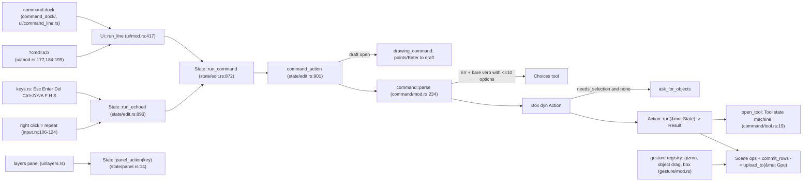
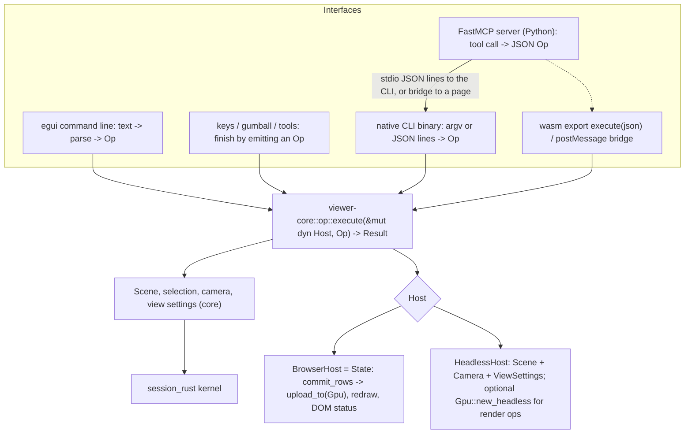

# Session Viewer — interface inventory (Phase 7: CLI and FastMCP)

Scope: `session/session_viewer` at the current checkout. Read-only audit: nothing was built or run; every statement cites the file it was read from. Paths are relative to `session_viewer/` unless they start with `../`.

Background is not repeated here: browser integration is in [ARCHITECTURE.md §9](ARCHITECTURE.md#9-webassembly--browser-integration), the coupling that blocks automation in [§10.1-10.2](ARCHITECTURE.md#101-god-objects--tight-coupling), the target crates and `CommandHost` in [§11](ARCHITECTURE.md#11-target-architecture-proposal--not-implemented), and the per-feature status of the automation hooks in [FEATURE_INVENTORY.md §6](FEATURE_INVENTORY.md#6-automation).

## 0. Verdict: no CLI and no MCP server exist today

| Searched | Where | Result |
|---|---|---|
| `fastmcp`, `mcp` (whole word, case-insensitive) | `session/` and the superproject `wood_research/`, excluding `target`, `node_modules`, `.git`, `docs/lessons`, archives | Only this audit's own files, plus `../../.claude/skills/verify/SKILL.md:29` (the user's external `image` MCP at `~/.local/share/mcp-image/server.py`, which uses `mcp.server.fastmcp.FastMCP` but has nothing to do with the viewer) and `../../.agents/skills/fd/SKILL.md:40-41` (an external `mcp-server-brg` knowledge server). No `.mcp.json` in the superproject, `session/` or `session_viewer/`. |
| `clap`, `structopt`, `std::env::args`, `argparse`, `sys.argv`, `[[bin]]` | same trees | `session_viewer/Cargo.toml` has **no `[[bin]]`** and no argument-parser dependency; `src/main.rs` does not exist. The only `[[bin]]` in `session/` is the kernel's `pdf_import` (`../session_rust/Cargo.toml:43-46`, feature `pdf`). Viewer `examples/*.rs` read positional `std::env::args` (fixture generators, `selftest`). The other hits are test or audit scripts. |
| `#[wasm_bindgen]` exports | `src/` | `run_web` (start, `app/runtime.rs:11-12`), `reload_scene(Option<String>)` (`app/loader.rs:240-253`), `TextQuality` page API (`text_quality.rs:31-70`). **No command or operation export.** |

What comes closest to a CLI is the native render harness `examples/selftest.rs:24-38`: `selftest <out.ppm> <scene.yaml|file.pb>...` with `VIEWER_W/H` and the `VIEWER_*` environment knobs (`src/selftest.rs:34-66`). It loads and draws one frame and exits. It cannot run a command. `../session_cpp/examples/native_viewer_gallery.py:26-30` already uses it as a renderer (`VIEWER_RENDERER`, default `.../release/examples/selftest.exe`).

## 1. How every operation is reached today



Facts that hold for every command verb:

| Property | Behaviour | Source |
|---|---|---|
| Input | One text line, at most 64 KiB, words split on whitespace; the longest registered name or alias wins, case and inner spaces ignored (`clippingplane` = `Clipping Plane`) | `command/mod.rs:82-118,234-257` |
| Arity | `Spec.arity` enforces an exact word count when set | `command/mod.rs:252-254` |
| Numbers | `number()` rejects non-finite values; points `x,y,z` via `coords::absolute`, offsets `10 0 0` / `@10,0` / `10<45` via `offset()`; drawing points must be finite and within ±1e12; at most `MAX_POINTS = 4096` | `command/mod.rs:363-413`, `verbs/geometry.rs` `Draw::parse`, `point()`, `app/modeling.rs:13` |
| Output | `Result<String, String>`: a human sentence only. No structured payload, no error code. | `command/mod.rs:11-13` |
| Errors | Free text (`"nothing to undo"`, `"wrong number of arguments for `X`"`, `"no command `x`"`). A bare verb that has at most 10 options and fails to parse opens a `Choices` tool instead of failing. | `state/edit.rs:908-918`, `command/mod.rs:352-360` |
| Selection gate | `needs_selection()` verbs with nothing selected start a "select objects, then Enter" prompt instead of running (Rhino-style) | `state/edit.rs:931-933` |
| Side effects common to all | cancels the current gesture and mark; cancels the draft unless `keeps_draft`; cancels a pending split unless `keeps_split`; on success stores the line for right-click repeat; status text and history go to the DOM (`feedback::status`, `command_history`) | `state/edit.rs:872-933`, `app/feedback.rs` |
| Scene access | `Action::run(&self, state: &mut State)`. `State` owns the window, `Gpu`, camera, scene, selection and tool. Nothing can run without a window and a GPU. | `command/mod.rs:13`, `state.rs:41-69` |
| Interactive verbs | Many verbs typed bare (and all primitive solids, even fully typed) open a `Tool` (`open_tool`), a state machine fed by clicks, typed words and Enter (`placed`, `word`, `enter`, `picked`). Typed answers are replayed into the tool: `tool/shape.rs:504-520` `Start::run` opens the tool, then runs the typed words as a second command line. | `command/tool.rs:19-148`, `tool/shape.rs:469-520`, `tool/gather.rs:198` |

Legend for the tables below. Scene access: **S** = `Scene` (documents, rows, undo), **Sel** = selection (`Scene.selected`, `State.selection`, `selection_order`), **Cam** = camera, **V** = `gpu.view` display settings, **Go** = `gpu.objects` (CPU mirror of the GPU row table: row bounds and flags, `engine/gpu/objects/table.rs`), **T** = interactive tool or draft, **F** = `features` (snap, cplane, gizmo, clipping), **DOM** = browser page. R = read, W = write.
CLI/MCP columns judge suitability **for the proposed shared core (§4)**, not today's reachability (nothing is reachable today). "y" means the operation has typed inputs, a deterministic result and no need for a pointer. "n" means it is UI chrome or needs a pointer. "typed" means only the fully typed form fits; the bare form is an interactive tool.

## 2. Command verbs (`REGISTRY`, `src/app/command/verbs/mod.rs:19-100`: 80 verbs + test-only `Wedge`)

### 2.1 Create geometry

| Verb (aliases) · file | Inputs | Output | Validation / errors | Side effects | Scene | CLI | MCP |
|---|---|---|---|---|---|---|---|
| `Point` · `point.rs` | 1 point `x,y,z`, or none (draft) | "Created and selected point on <layer>…" (`geometry.rs:156-165`) | count, finite, ±1e12 | new geometry in current layer or `Created` doc (`modeling.rs:24-30`), one undo step, selects it | S W, Sel W | y | y |
| `Line` · `line.rs` | 2 points | same | "Line needs 2 points" | same | S W, Sel W | y | y |
| `Arrow` · `arrow.rs` | 2 points (start, tip) | same | same | same | S W, Sel W | y | y |
| `Polyline` · `polyline.rs`; options `Points`, `Rectangle`, `Polygon` | ≥2 points; Rectangle/Polygon are tool modes | same | "needs at least N points" | same; Enter finishes the open draft | S W, Sel W, T | typed points: y; Rectangle/Polygon: n (tool only) | same |
| `Curve` · `curve.rs` | control points | "…NURBS curve…" | point count | same; `Close` button | S W, Sel W | y | y |
| `Close` (arity 0) · `close.rs` | none | result of `close_drawing` | needs an open draft | closes the drafted polyline/curve | T W | n (draft state) | n |
| `Box` (`bo`), `Sphere`, `Cylinder`, `Cone`, `Pyramid`, `Torus`, `Block With Hole`, `Tetrahedron`, `Octahedron`, `Dodecahedron`, `Icosahedron` · one file each; option `Brep`/`Mesh` (`BREP_MESH`) | option, then point and numbers per the hint, e.g. `Box Brep 0,0,0 100 50 30`, `Torus 0,0,0 20 5`, `Block With Hole 0,0,0 40 30 20 5` | prompt, then the created message | each word must parse as a point or number (`shape.rs:475-486`), a refused answer cancels the draft | opens a `Shaping` tool even when fully typed, then replays the words (`shape.rs:504-520`); one undo step; selects result | S W, Sel W, T, F R (cplane frames the base) | typed: y | typed: y |
| `Capsule`, `Quad Sphere` · option `Mesh` only (`MESH_ONLY`) | point, radius, height / radius | same | same | same | same | typed: y | typed: y |
| `Nurbs Curve Circle`, `Nurbs Curve Ellipse`, `Nurbs Curve Arc` (`Center`/`3 Points`), `Nurbs Curve Parabola` | center/start, radii/angles per hint | same | same | same | same | typed: y | typed: y |
| `Nurbs Surface 4 Points` (`nurbssurface_4_points`) | 4 corner points | same | point parse | `Gathering` tool (`tool/gather.rs`) | S W, T | typed: y | typed: y |
| `Loft` (`Open`/`Closed`), `Nurbs Surface Loft` (`Smooth`/`Straight`), `Nurbs Surface Network`, `Nurbs Surface Sweep1`, `Nurbs Surface Sweep2` | curves picked in order (or preselected), option | "Lofted N curves into a NURBS surface" (`loft.rs` `build`) | section alignment / planarity (`tool/surfacing.rs:64-150`) | `Gathering` tool; creates surface(s) | S R/W, Sel R, T | y if the curves are given as ids (needs §4 `ObjectRef`) | y, same condition |
| `Extrude` (`Cap On`/`Cap Off`) · `extrude.rs` | curves, then distance or `x,y,z` | created | same | `Gathering` tool | S R/W, Sel R, T | y with ids | y with ids |
| `Nurbs Surface Revolve` | profile curves, axis start, axis end, angle | created | same | `Gathering` tool | S R/W, T | y with ids | y with ids |
| `Text` · `text.rs` | 1..80 characters (`MAX_CHARS`, `text.rs:17`), then a lower-left point; `Height N` | prompt / created | char count | opens `Placing` tool; default height from camera distance (`text.rs` `run`) | S W, Cam R, T | y with explicit point and height | y, same |
| `BoundingBox` (arity 0) · `bounding_box.rs` | selection | created OBB | needs selection; released docs must be back (`measure::loading`) | creates box geometry | S R/W, Sel R | y | y |
| `Clipping Plane` · `clipping_plane.rs`; options `Normal`, `3Point`, `XY`, `YZ`, `ZX`, `Flip`, `On`, `Off`, `Fill`, `Fill Hatch`, `Fill Solid` | origin + side point, or `XY 0,0,1200`, or a switch | status text | usage string on bad words | creates a clipping-plane object (`app/clipping.rs`); Flip acts on the selected plane; `needs_selection` for Flip | S W, F W, Sel R | typed: y | typed: y |

### 2.2 Delete, edit topology

| Verb | Inputs | Output | Validation / errors | Side effects | Scene | CLI | MCP |
|---|---|---|---|---|---|---|---|
| `Delete` (`del`, arity 0) | selection | `delete_selection` text | needs selection; locked rows refused | `Scene::delete_rows` (`app/edit.rs:187`) one undo step, an element with its parts | S W, Sel W | y | y (destructive: confirm) |
| `Explode` (arity 0) | selection | count message | locked refused; sub-object selection refused | `explode_rows`: polyline→lines, BRep/mesh→faces, cloud→points | S W, Sel W | y | y |
| `Split` (arity 0) | selected curve or face, then cutter curves, Enter | prompt | needs a curve or face | split tool (`app/splitting.rs`), `keeps_split` | S W, T | n (picks cutters); y once cutters are ids | same |
| `Trim` · `trim.rs` + `trim/parts.rs` | bare: pick objects, cutters, parts (tool); typed `Trim 0.2 0.8` keeps a parameter interval | "geometry updated" | `range()` needs 2 numbers | typed form calls `Scene::edit_interval` (`modeling.rs:177`), one undo step | S W, Sel R, T | typed: y | typed: y |
| `Extend` · `extend.rs` + `extend/reach.rs`; option `Distance` | bare: boundaries, ends (tool); `Extend Distance 5`; `Extend -0.2 1.2` | same | same | same | S W, Sel R, T | typed: y | typed: y |
| `Project To Plane` · options `CPlane`, `XY`, `YZ`, `ZX`, `3Point` | selection, plane | count message | locked refused; texts skipped | flattens points, lines, polylines, curves, meshes; CPlane = the plane the view faces (camera-dependent) | S W, Sel R, Cam R (CPlane) | XY/YZ/ZX: y; CPlane/3Point: n | same |
| `Arrowhead` (arity 1) · `None`/`Start`/`End`/`Both` | selection, option | count message | locked refused | edits curve arrowhead fields, undoable | S W, Sel R | y | y |
| `Add Group` [name] | selection, optional name | text | name must not contain `/`; locked refused | new tree group node; reveals and refreshes layers panel | S W, Sel R, DOM | y | y |
| `Add Edge` (arity 0) | exactly two selected objects | text | locked refused | `Scene::connect` adds a session graph edge; opens the Graph table (DOM) | S W, Sel R, DOM | y | y |

### 2.3 Transform

| Verb | Inputs | Output | Validation / errors | Side effects | Scene | CLI | MCP |
|---|---|---|---|---|---|---|---|
| `Move` (`m`) | bare: base + target (tool); typed offset `10 0 0`, `@10,0`, `10<45` | "move" | offset parse; locked refused | `State::apply` → `transform_rows` (`app/edit.rs:10`) or `edit_subobject` for a face/edge/control selection (`state/edit.rs:840-861`); one undo step; offsets are along the construction plane axes unless world (`command/mod.rs:374-385`) | S W, Sel R, F R (cplane) | typed: y | typed: y |
| `Copy` | bare: base + many targets; typed offset | copy message | same | `copy_selection`, originals stay selected | S W, Sel R | typed: y | typed: y |
| `Rotate` (`rot`), options `x`/`y`/`z` | bare: center + angle or 2 refs; typed `Rotate z 45` | "rotate" | axis letter + finite number, ≤2 words | pivot = **gumball origin** if a gizmo exists, else none (`rotate.rs` `run`, `state/edit.rs:512-519`): the pivot is implicit UI state | S W, Sel R, F R (gizmo) | typed: y if the pivot is made explicit | same |
| `Scale` (`s`) | bare: origin + factor or refs (1D/2D/3D); typed `Scale 2` | "scale" | factor > 0, one word | pivot = gumball origin (same caveat) | S W, Sel R, F R | typed: y (explicit pivot) | same |
| `Orient 3 Points` (`orient3pt`) | bare: tool; typed 6 points | text | exactly six points | rigid transform of the selection | S W, Sel R | typed: y | typed: y |
| Gumball drag / typed number box (not a verb) | pointer drag on a handle; typed value | none (status) | handle hit-test, scale floor 0.01 (`app/gizmo.rs`) | one undo step per drag (`state/edit.rs:68-201,835`) | S W, Sel R, F W | n (pointer) | n; covered by Move/Rotate/Scale ops |
| Object drag (not a verb) | pointer | none | – | `state/drag.rs:105-420` | S W | n | n |

### 2.4 Select

| Verb | Inputs | Output | Validation / errors | Side effects | Scene | CLI | MCP |
|---|---|---|---|---|---|---|---|
| `Select All` (arity 0; Ctrl+A) | none | "N selected" | – | selects visible, unlocked rows; element attributes excluded | Sel W, S R, **Go R** (`selecting.rs:14-29` reads `FLAG_HIDDEN` from `gpu.objects`) | y | y |
| `Select By Name` text | substring (quotes allowed) | "N selected" | error when nothing matches, selection unchanged | – | Sel W, S R, Go R | y | y |
| `Select Small` length (arity 1) | number | "N selected" | error when nothing below | – | Sel W, **Go R** (`row_bounds`) | y | y |
| `Select Lasso` (arity 0) | pointer loop; Shift adds, Ctrl removes | count | – | `select_lasso.rs` tool | Sel W, Cam R, T | n | n |
| Box selection Window/Crossing (gesture, not a verb) | pointer rectangle | – | sampled, no occlusion test | `state/box_select.rs`, `verbs/selecting.rs:166` | Sel W, Cam R | n | n (a typed `select.in_box(world AABB)` could replace it) |
| Click pick (gesture) | pointer | – | GPU id pass, answer frames later | `State::request_selection` (`state.rs:703`) | Sel W, GPU | n | n |
| `Object`, `Edge`, `Face` (hint-less) | none (extra words → "no command") | "<Mode> selection" | – | clears selection, sets `selection_tool` for later clicks | Sel W | n (click mode) | n |
| `Controls` | none | "Control points" | same | `enable_controls` (`state.rs:836`) | Sel W | n | n |
| `Escape` (`esc`, arity 0; Esc key) | none | "cancelled" / "selection cleared" | – | cancels draft, else clears selection | T W, Sel W | y as `selection.clear` | y as `selection.clear` |

### 2.5 Query and measure

| Verb | Inputs | Output | Validation / errors | Side effects | Scene | CLI | MCP |
|---|---|---|---|---|---|---|---|
| `Length` (arity 0) | selection | total length text, count | `measure::loading` errors "try again" while released documents are fetched back | draws a measured mark in the scene until next command (`measure.rs:7`) | S R, Sel R | y | y |
| `Area` (arity 0) | selection or one face | total area text | same | mark | S R, Sel R | y | y |
| `Volume` (arity 0) | selection | total volume, names of open objects | same | mark | S R, Sel R | y | y |
| `Length BoundingBox` (arity 0) | selection | "X … · Y … · Z … <unit>" | same | mark | S R, Sel R | y | y |
| `Measure Distance` | 2 points typed, or pick with snaps | distance text | "takes two points" | mark | Cam/snap R for picks | typed: y | typed: y |
| `?inspect=1` snapshot (not a verb) | URL flag | JSON on `canvas[data-viewer-inspection]` (≈90 keys) | – | serialises every frame it publishes | all R | n (browser DOM) | y as a resource (`scene/inspect`) |

### 2.6 Layers, visibility, document

| Verb / action | Inputs | Output | Validation / errors | Side effects | Scene | CLI | MCP |
|---|---|---|---|---|---|---|---|
| `Hide` (arity 0; H) | selection | "hidden" | – | `hide_selected` | S W | y | y |
| `Show` (arity 0; S) | none | "everything shown" | – | `show_all` | S W | y | y |
| `View Hide Selected`, `View Show All` | none | text | – | same as Hide/Show via `view.rs` | S W | y | y |
| `Layers` · `On`/`Off`/`All` | option | "Layers (On Off All)" | – | panel visibility (DOM state via `feedback::layers_visible`), `All` expands rows | DOM | n (UI) | n |
| `Element Attributes` `On`/`Off` | option | text | – | `show_attributes` re-walk | S W | y | y |
| `Element Interactions` `On`/`Off` | option | text | – | `show_interactions` | S W | y | y |
| Panel actions (string keys, not verbs): `select/<i>`, `add/<i>`, `open/<i>`, `hide/<i>`, `lock/<i>`, `current/<i>`, `new_layer`, `new_sublayer`, `rename/<i>/<name>`, `delete_layer`, `duplicate_layer`, `change_layer`, `copy_layer`, `color/<i>/<face\|edge>/<hex\|original>`, `pair/...` | tree-node **index** `<i>` into `features.hierarchy.nodes` | none (void) | silent on bad keys | layer CRUD in `app/layers.rs:257-596` | S W, Sel W | y only after re-keying by `(doc, layer path)` or guid; indices are volatile | same |
| `Undo` (Ctrl+Z), `Redo` (Ctrl+Y, Ctrl+Shift+Z) | none | "undone"/"redone" | "nothing to undo/redo" | `Scene::undo/redo` (`app/edit.rs:244-249`) + `after_history` clears selection and tool | S W, Sel W | y | y |
| `Save` (arity 0) | none | "Saved complete session (N bytes)" | refuses streamed clouds/sheets and released docs (`session_io.rs:141-150`); 512 MiB | wasm: browser download `session.session` | S R, DOM | y as `scene.save(path)` (pure `session_io::save`) | y (returns path or bytes size) |
| `Open` (arity 0) | none | "Choose a .session file" | magic, 512 MiB, inventory checks (`session_io.rs:245-…`) | wasm: file picker, `install_saved_scene` replaces the scene (`loader.rs:1038`) | S W, DOM | y as `scene.open(path)` (pure `session_io::open`) | y |
| `Report` (arity 0) | none | "Report downloaded" | – | downloads diagnostics JSON (`feedback.rs:237`, `assets/diagnostics.js:56`) | DOM | n | n (browser only) |

### 2.7 Camera and render mode

| Verb | Inputs | Output | Validation / errors | Side effects | Scene | CLI | MCP |
|---|---|---|---|---|---|---|---|
| `View` `Top`/`Side`/`Right`/`Front`/`Back`/`Left`/`Bottom`/`Isometric`/`Isometric Back` | option | text | "Choose a View direction or display setting" | `Camera::set_view` (`camera.rs:381`), `keeps_draft` | Cam W | y (headless render) | y |
| `View Reset`, `View Perspective`, `View Orthographic` | option | text | same | camera reset / `toggle_projection` (`camera.rs:233`) | Cam W | y | y |
| `Fit` (arity 0; F; double tap) | selection or all | "fitted" | – | `fit_selected_or_all` uses `gpu.objects.row_bounds` and `gpu.bounds` (`state.rs:205-232`) | Cam W, **Go R** | y | y |
| `View Show/Hide Edges/Lines/Points`, `View Outline [On/Off]`, `View Lighting [On/Off]`, `View Backfaces [On/Off]`, `View Xray [On/Off]`, `View Point Size N`, `View Plane Size N`, `View Names` | option, value > 0 for sizes | text | positive finite number | `gpu.view` flags | V W | y | y |
| `Arctic` `On`/`Off` | option or toggle | "Arctic On/Off" | – | `set_arctic`: SSAO, also turns outlines on (`engine/gpu/view.rs:24-29`) | V W | y | y |
| `Outline` `On`/`Off` | option or toggle | "Outline On/Off" | – | `show_outlines` | V W | y | y |
| `Opacity` 0..1 | number | "Opacity v" | finite number | `set_opacity` | V W | y | y |
| `Construction Plane` `XY`/`XZ`/`YZ`/`3 Point …`/`View` | option or 3 points | text | usage string | sets `CPlane` (`app/cplane.rs`), grid follows | F W | y | y |
| `Snap` `On`/`Off`/`End`/`Near`/`Mid`/`Center`/`Perp` | option | text | – | `features.snap` (also sets dead flag `snap.bar`) | F W | n (interactive aid only) | n |
| `Grid Snap` `On`/`Off`/spacing | option or number | text | number | `features.snap.grid/grid_step` | F W | n | n |
| Orbit / pan / zoom (mouse, touch; not verbs) | pointer | – | – | `camera.rs:111-205` | Cam W | n; a `camera.set_pose` op replaces it | y as `camera.set_pose` (not implemented) |

## 3. Non-verb surfaces

### 3.1 Keyboard shortcuts (`src/app/keys.rs:5-48`)

Every shortcut is a command line through `State::run_echoed`, so it adds no operation of its own.

| Key | Runs | Condition |
|---|---|---|
| Esc | `state.escape()` | canvas focused (`runtime.rs:295`) |
| Enter | `state.enter()` (finish tool/draft) | same |
| Delete | `Delete` | not with Ctrl |
| Ctrl/Cmd+Z, Ctrl+Y, Ctrl+Shift+Z | `Undo`, `Redo`, `Redo` | text field without typed text |
| Ctrl/Cmd+A | `Select All` | same |
| F / H / S (bare letters) | `Fit` / `Hide` / `Show` | any other printable key opens the command line (`ui/mod.rs:225-245`) |
| Right click | repeat last command, or Enter while drafting | `input.rs:106-124` |

There is no F10 binding (`state.rs:838` and 6 Playwright tests still mention F10) and no `T` binding (`state.rs:66` comment only).

### 3.2 URL query parameters (browser) and environment knobs (native)

All go through `engine/gpu/view.rs:174` `query()` (wasm) or `knob(env, query)` (`view.rs:142-153`: the env var natively, the query in the browser). Parsing is first-match `name=value`, URI-decoded, a bare `name` reads as `""`.

| Parameter | Type / values | Effect | Validation | Source |
|---|---|---|---|---|
| `scene` | relative path; `.yaml` and `scenes/` implied | manifest to load | refuses `..` segments, leading `/`, `//`, `:` | `app/route.rs:57-71,102-118` |
| path segment `/view_x` | name | same as `scene` | refuses `.html`, `:`, leading `.` | `route.rs:46-54` |
| `data` | `https://…`, localhost URL, `off`/empty (same origin) | base URL of `file:` entries; default R2 bucket `DATA_BASE` | others warned and ignored | `route.rs:74-90`, `:2` |
| `live` | `off`/`0`, `https://…` or localhost manifest | watch a manifest (default `view_live.yaml` on R2) | others → default | `app/live.rs:125-149` |
| `poll` | seconds ≥ 1 (default 5) | live poll interval | else default | `live.rs:150-156` |
| `notify` | `off`/`0`, `https://…` SSE URL | relay (default ntfy `DEFAULT_NOTIFY`, `live.rs:20`) | localhost sources never use a relay | `live.rs:157-162` |
| `cmd` | `;`-separated command lines | runs one line per frame once geometry is shown or after 600 frames | per-line `parse` errors go to status | `ui/mod.rs:177,184-199,408` |
| `inspect` | `1` | publish `data-viewer-inspection` (state) and `data-viewer-ui` (controls) JSON attributes | exact `1` | `app/inspection.rs:8`, `ui/mod.rs:166,379-396` |
| `stage`, `chapter`, `step`, `theme` | deck path, usize, usize, theme name | open a slide deck mode | parse failures fall back | `app/stage/application.rs:44-54,291` |
| `recovered` | reason text | written after device-loss reload | – | `route.rs:136-200` |
| `points`, `segments` | u32 | streamed cloud points (default 6,000,000) / sheet segments (3,000,000) budgets | integer parse | `app/loader.rs:113-138` |
| `budget` (`VIEWER_BUDGET`) | MB | scene byte budget (default 16 MB per GB of device memory) | integer parse | `loader.rs:672-687` |
| `gpu` (`VIEWER_GPU`) | `low`/`default`/`high` | adapter power preference | others ignored | `engine/gpu/context.rs:140-145` |
| `dpr` (`VIEWER_DPR`) | f32 ≥ 0.5 | DPR cap (default 2.0) | below 0.5 → default | `view.rs:94-110` |
| `msaa` (`VIEWER_MSAA`) | u32 | forced sample count | parse | `view.rs:52` |
| `opacity` (`VIEWER_OPACITY`) | 0..1 | face opacity (default 0.95, phone 1.0) | clamped | `view.rs:50,66-79` |
| `lit`, `backface`, `outlines`, `perf`, `spin`, `nogrid`, `nomarkers` (`VIEWER_LIT`, …) | presence flags | lighting, backfaces, outlines, per-frame timing line, auto-orbit, hide grid, hide markers | presence only | `view.rs:36-54` |
| `cloud`, `edl`, `lod`, `thickness`, `aa` (`VIEWER_CLOUD_SCALE`, `VIEWER_EDL`, `VIEWER_LOD`, `VIEWER_THICKNESS`, `VIEWER_AA`) | f32 | point scale, EDL strength, LOD px, line thickness (≥0.1), AA feather (0.5..4) | finite, clamped | `view.rs:43-47,155-170` |
| `VIEWER_GPU_TIMING` (native only) | presence | GPU timestamp queries | – | `context.rs:146-147` |
| Native harness only: `VIEWER_W/H/ORBIT/ORTHO/VIEW/ZOOM/TARGET/DISTANCE_SCALE/CLIP/SELECT/AO/DPR/LABELS/FRAMES/TIER/IDS/PICK/PROFILE` | env | camera, size, frames, pick tests | – | `examples/selftest.rs:30-37`, `src/selftest.rs:86-140,427-565` |

CLI: the query parameters are startup configuration, not operations. A CLI needs the subset that is scene/camera/render state (`scene`, `data`, `cmd`, render knobs), which the proposal maps to ops. MCP: `cmd` and `inspect` are the only existing remote-control hooks; neither returns a result to the caller.

### 3.3 JS / wasm-bindgen / page globals

| Surface | Signature | Direction | Validation | Source | CLI | MCP |
|---|---|---|---|---|---|---|
| `run_web` | `() -> Result<(), JsValue>`, `wasm_bindgen(start)` unless feature `tutorial` | page → wasm | – | `app/runtime.rs:11-12` | n | n |
| `reload_scene` | `(url: Option<String>)`; `None` reloads the page's own route, keeps camera; increments `LOAD_GENERATION` so stale loads stop | page → wasm | warns when there is no route | `app/loader.rs:240-253` | n | y (via a page bridge) |
| `postMessage {type:'session-viewer:reload-scene', scene?}` | from `window.parent` or same origin only | embedder → page | origin check | `index.html:260-274` | n | y (bridge) |
| `window.viewerDiagnostic(kind, message)`, `window.viewerDiagnostics.{read(), download()}` | report v1 JSON in `localStorage` (3 kept) | wasm/page → JS | – | `assets/diagnostics.js:67,84` | n | y as a perf resource via bridge |
| `downloadSession(bytes)`, `chooseSession()` | inline JS imported by Rust | wasm → JS | 512 MiB in JS | `app/session_io.rs:335-357` | n | n |
| `DecompressionStream("gzip")` | imported constructor | wasm → JS | – | `app/fetch.rs:291-305` | n | n |
| `TextQuality.create(canvas)`, `.render(scale, selected, bg)`, `.render_nameplate(scale)`, `.specimens()` | separate page `assets/text-quality.html` | page → wasm | – | `text_quality.rs:31-70` | n | n |
| `canvas[data-viewer-inspection]`, `canvas[data-viewer-ui]` | JSON attribute strings | wasm → DOM | only with `?inspect=1` | `inspection.rs:158`, `ui/mod.rs:395` | n | y (read-only resource) |
| `#command-agent` hidden input | phone keyboard events (`Msg::Agent`) | page → wasm | – | `app/agent.rs`, `ui/phone.rs:14` | n | n (not an automation agent despite its name) |

### 3.4 Live and streaming channels

| Channel | Protocol | Direction | Payload | Source | Note |
|---|---|---|---|---|---|
| Live manifest poll | HTTP GET with ETag + byte hash, every `poll` s | server → page | YAML manifest, `.pb` | `app/live.rs`, `app/live_revision.rs` | replaces the scene, keeps the camera |
| Live relay | `EventSource` SSE (ntfy) | server → page | "something was published" flag, checked every 100 ms | `live.rs:16-60` | one-way; publisher `../../bash/publish-scene.sh` (curl to R2 + ntfy, `:30,94`), `../bash/view_live.sh` (gzip ≤ 32 MiB, `:40-47`) |
| Range streaming | HTTP `Range: bytes=` | server → page | cloud `coords/colors/normals/ids`, sheet arrays | `app/fetch.rs:175-197`, `app/stream.rs`, `loader.rs:741-1017` | internal loading, not an operation |
| Hydrate | HTTP GET | server → page | a released document, refetched for edit or save | `loader.rs:1019` | – |
| Fonts, stage decks, pictures | HTTP GET | server → page | `.ttf`/`.otf`, deck YAML, PNG | `app/fonts.rs:43-47`, `app/stage/*` | – |
| Python `serve()` / `show()` | local `ThreadingHTTPServer` over `session_viewer/dist`; Jupyter `IFrame`; JupyterLite `#session=<base64>` | Python → page (files) | `net.pb` + `scene.yaml` | `../session_py/src/session_py/viewer.py:23-179` | display only; the `#session=` reader was not found in `src/` (see the feature part §3) |

No WebSocket, `BroadcastChannel` or Worker exists (`grep -rniE 'websocket|BroadcastChannel|Worker' src assets index.html`: only `EventSource` in `live.rs`). **No channel carries an operation request or a result into or out of a running page.**

### 3.5 Performance information

| Source | What | Access | Source file |
|---|---|---|---|
| `?inspect=1` | `frames`, `draw_calls`, `navigation_tier`, `interacting`, `rough`, `pick_busy`, `gpu_buffer_capacity_bytes`, `gpu_texture_estimate_bytes`, `wasm_capacity_bytes`, `source_cpu_known_payload_bytes`, `row_table_bytes`, `dead_rows/bytes`, `tombs`, `display_refinement`, `instancing` | DOM JSON | `app/inspection.rs:23-158` |
| `?perf` | per-frame timing line (`gap`, `encode_ms`) | screen text | `state.rs:660,773`, `engine/performance.rs:320` |
| Phase marks | `decode`, load phases → `viewerDiagnostic` | report JSON | `app/feedback.rs` `phase`, `assets/diagnostics.js` |
| Native GPU timing | `PassTimer` timestamps | stdout of `selftest` | `engine/gpu/timing.rs`, `VIEWER_GPU_TIMING` |

## 4. Proposal: one shared core API (not implemented)

Constraint from the brief: automation must not get a second geometry engine. The kernel (`../session_rust`) stays the only geometry code; the viewer's `Scene` stays the only scene model. The proposal adds a typed operation layer above `Scene` and below every interface. It is the `CommandHost` and `viewer-automation` of [ARCHITECTURE.md §11](ARCHITECTURE.md#11-target-architecture-proposal--not-implemented), made concrete.



### 4.1 Types

```rust
// viewer-core::op (proposal)
#[derive(Serialize, Deserialize)]
pub struct Request { pub id: Option<String>, #[serde(flatten)] pub op: Op }

#[derive(Serialize, Deserialize)]
#[serde(tag = "op", rename_all = "snake_case")]
pub enum Op {
    // create / edit (rename of today's verbs; typed forms only)
    ObjectCreate { kind: CreateKind, layer: Option<LayerRef> },   // point/line/arrow/polyline/curve/primitive/surface/text
    ObjectDelete { targets: Targets },
    ObjectTransform { targets: Targets, xform: XformSpec },       // Translate{v} | Rotate{axis, degrees, pivot} | Scale{k, pivot} | Orient3{from, to} | Matrix{m}
    ObjectCopy { targets: Targets, xform: XformSpec },
    ObjectExplode { targets: Targets },
    ObjectProject { targets: Targets, plane: PlaneSpec },
    CurveInterval { target: ObjectRef, t0: f64, t1: f64 },       // Trim a b / Extend a b
    CurveArrowhead { targets: Targets, head: Head },
    // select
    SelectionSet { targets: Targets, mode: SetMode },            // Replace | Add | Remove
    SelectionQuery { by: Filter },                                // All | Name(substr) | SmallerThan(len) | InBox(aabb)
    SelectionClear,
    // layers / tree / graph
    LayerList, LayerCreate { parent: Option<LayerRef>, name: String }, LayerRename { layer: LayerRef, name: String },
    LayerDelete { layer: LayerRef }, LayerSetCurrent { layer: LayerRef },
    LayerSet { layer: LayerRef, visible: Option<bool>, locked: Option<bool>, color: Option<ColorSpec> },
    GroupAdd { targets: Targets, name: String }, GraphAddEdge { a: ObjectRef, b: ObjectRef },
    VisibilitySet { targets: Targets, visible: bool }, ShowAll,
    // query
    SceneInspect,                                                 // today's ?inspect=1 keys, typed
    ObjectList { filter: Option<Filter> }, ObjectGet { target: ObjectRef },
    Measure { what: Measure, targets: Targets },                  // Length | Area | Volume | BoundsExtent | Distance{a,b}
    // document / io
    SceneOpen { path_or_url: String }, SceneSave { path: String }, SceneLoadManifest { path_or_url: String },
    HistoryUndo, HistoryRedo,
    // camera / render
    CameraGet, CameraSetView { view: View }, CameraSetPose { target: [f64;3], position: [f64;3], up: [f64;3], perspective: bool },
    CameraFit { targets: Option<Targets> },
    ViewGet, ViewSet { patch: ViewPatch },                        // arctic, outline, opacity, edges, lines, points, lighting, backfaces, xray, point_size, plane_size, names
    ConstructionPlaneSet { plane: PlaneSpec }, ClippingPlaneAdd { plane: PlaneSpec }, ClippingSet { on: Option<bool>, fill: Option<Fill> },
    RenderFrame { width: u32, height: u32, path: String },        // headless only
    PerfStats,
    // escape hatch, so every existing verb is reachable on day one
    CommandRun { line: String },
}

pub struct ObjectRef { pub doc: DocRef, pub guid: String }  // never a row index or a tree-node index
pub enum Targets { Selection, Refs(Vec<ObjectRef>) }

#[derive(Serialize)] pub struct Reply { pub message: String, pub created: Vec<ObjectRef>, pub changed: Vec<ObjectRef>, pub value: serde_json::Value }
#[derive(Serialize)] pub struct OpError { pub code: ErrorCode, pub message: String }
pub enum ErrorCode { InvalidArgument, NotFound, Locked, NoSelection, NotRetained /* released or streamed doc */, Busy /* load in progress */, TooLarge, Unsupported }

pub trait Host {                     // = ARCHITECTURE.md §11 CommandHost
    fn scene(&mut self) -> &mut Scene; fn camera(&mut self) -> &mut Camera; fn view(&mut self) -> &mut ViewSettings;
    fn commit(&mut self);            // State: scene.sync + upload_to(gpu) + redraw; headless: scene.sync only
    fn status(&mut self, text: &str);
}
pub fn execute(host: &mut dyn Host, op: Op) -> Result<Reply, OpError>;
```

### 4.2 How each interface calls it

| Interface | Path | What changes in today's code |
|---|---|---|
| egui command line | `command::parse(line)` keeps the vocabulary in `Spec`, but each typed `parse` returns an `Op` (or an interactive tool when bare). `Action::run` becomes `execute(state, op)`. | `Spec.parse: fn(&str,&[&str]) -> Result<Parsed, String>`, `enum Parsed { Op(Op), Tool(Box<dyn Tool>) }`. Interactive tools (`Moving`, `Shaping`, `Gathering`, `Trim`, lasso, gumball) **finish by emitting an `Op`**, so one undo step and one code path. Keyboard shortcuts stay command lines. |
| Native CLI | new `[[bin]] session-viewer-cli` (`cfg(not(wasm32))`), `HeadlessHost` = `Scene::new()` + `session_io::open/save` + `Manifest::parse` + `decode::session_from_bytes`. Modes: `session-viewer-cli exec scene.yaml --op '{"op":"object_list"}'`, `--cmd "Move 10 0 0"` (through `parse` → `Op`), `serve --stdio` (JSON lines in/out). `render_frame` reuses `selftest::render_scene` / `Gpu::new_headless` (`engine/gpu/context.rs:127`). | No argument-parser dependency is required (positional argv like `examples/selftest.rs`); add one only if the flag set grows. |
| FastMCP server | Python package next to `../session_py` (e.g. `session_py/viewer_mcp.py`, or a separate `session_mcp` that depends on `session_py`): one `@mcp.tool` per `Op` variant, input schema = the variant's JSON fields; `@mcp.resource("scene://inspect")`, `scene://objects`, `scene://perf`. Transport: spawn `session-viewer-cli serve --stdio` and forward JSON lines. Geometry for `object_create` can be built with `session_py` types and sent as protobuf bytes (`Session.pb_dumps`, `session.py:2017`) through `scene_load_manifest`/a `geometry_add {pb_base64}` op. | No geometry logic in Python beyond what `session_py` already has. |
| Running browser page (optional, later) | wasm-bindgen `execute(request_json) -> reply_json` in the web crate, plus a `postMessage {type:'session-viewer:op'}` handler next to the existing reload handler (`index.html:260-274`). A FastMCP server reaches a live page only through a relay; the existing local server `session_py.viewer.serve()` could host a WebSocket or SSE back-channel. | Today only one-way channels exist (§3.4); a bidirectional channel is new work and needs an origin policy. |

### 4.3 What blocks the shared core today (evidence)

| Blocker | Evidence | Needed for |
|---|---|---|
| `Action::run(&self, &mut State)`; `State` holds `Arc<winit::Window>` and `Gpu` | `command/mod.rs:13`, `state.rs:41-69` | any headless op |
| Selection candidates, `Select Small` and `Fit` read `gpu.objects` row flags and bounds | `verbs/selecting.rs:14-29`, `select_small.rs` `run`, `state.rs:205-232` | select and fit ops headless; move row bounds and flags into core (`viewer-rows`, ARCHITECTURE §11) |
| Rotate/Scale pivot is the gumball origin | `rotate.rs` `run`, `scale.rs` `run`, `state/edit.rs:512-519` | explicit `pivot` in `XformSpec` |
| Primitive creation runs through the `Shaping` tool even when fully typed | `tool/shape.rs:504-520` | a pure `build(option, answers) -> Geometry` per shape, called by both tool and `Op` |
| Layer panel actions address tree nodes by index | `state/panel.rs:14-140`, `features.hierarchy.nodes` | `LayerRef` by `(doc, path)` |
| Results are free text | `command/mod.rs:13` | typed `Reply` / `OpError` |
| Released documents answer "try again" | `measure.rs:46`, `scene_release.rs:15` | `NotRetained`/`Busy` codes, or a host that awaits hydration |

Seams that already work without a GPU and make the first step small: `command::parse` and `completions` (tested without GPU, `command/tests.rs`), `Scene::new`, `add_file`, `identity_of`, `undo`, `model`/`create_geometry` (`modeling.rs:24-30`), `transform_rows` (`app/edit.rs:10`), `delete_rows` (`:187`), `session_io::save/open` (`session_io.rs:140,245`; tests build a `Scene` with no GPU, `session_io.rs:494-571`), `Manifest::parse` (`manifest.rs:79`) and `decode::session_from_bytes` (`decode.rs:226`).

Suggested first slice: `HeadlessHost` + `Op::{SceneLoadManifest, SceneOpen, SceneSave, ObjectList, ObjectCreate(Point|Line|Polyline|Curve), ObjectTransform(Translate|Matrix), ObjectDelete, HistoryUndo/Redo, Measure, CommandRun}`. Then route the command line's typed `Draw`, `Move`, `Copy`, `Delete`, `Undo` through `execute`, and add the FastMCP wrapper over the CLI. This matches ARCHITECTURE §11 migration step 2, then step 8.
