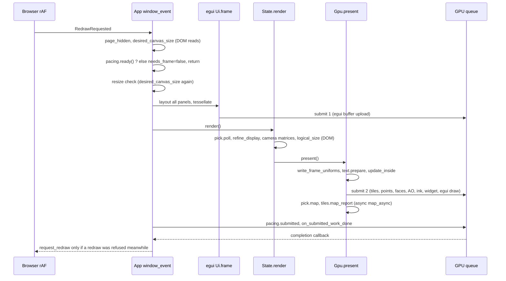

# Session Viewer: Performance Audit (Phase 6)

Scope: why the viewer "feels laggy". Source-only audit, HEAD `032cd8c0f`. No browser was run. *Update 2026-11-19:* native headless GPU numbers were measured afterwards and are in [§3.4](#34-measured-2026-11-19-native-headless-not-browser); everything else below was written before them. Every number below is either a file size I measured with `ls`/`gzip`, or is cited from a repo artifact. Everything else is labelled HYPOTHESIS with a way to confirm it.

Related, not repeated here: [docs/phone-performance.md](../docs/phone-performance.md) (device measurements, pacing work), [docs/performance-patterns.md](../docs/performance-patterns.md) (a course page: ownership patterns, no frame data), [ARCHITECTURE.md](../ARCHITECTURE.md) (memory model, MSAA budget).

## 1. Method and what was inspected

| Area | Files read |
|---|---|
| Frame scheduling | `src/app/runtime.rs` (whole), `src/engine/gpu/pacing.rs`, `src/state.rs:288-300, 500-690`, `src/engine/gpu/present.rs`, `src/engine/gpu/render.rs`, `src/engine/gpu/frame.rs` |
| Instrumentation | `src/engine/performance.rs`, `src/engine/diagnostics.rs`, `src/engine/gpu/timing.rs`, `src/app/inspection.rs`, `assets/diagnostics.js`, `src/selftest.rs:440-620`, `src/selftest/profile.rs` |
| Input / UI | `src/app/input.rs:110-260`, `src/app/ui/mod.rs:184-376`, `src/app/ui/pointer.rs`, `src/app/ui/layers.rs:120-215`, `src/engine/gpu/ui.rs`, `egui-winit-0.34.3/src/lib.rs:319-347` (vendored registry copy) |
| Buffers / upload | `src/engine/gpu/buffers.rs`, `upload.rs`, `upload_padding.rs`, `arena.rs` (symbol list), `objects/table.rs:423-463` |
| Readback / sync | every `map_async` / `poll` / `on_submitted_work_done` site (grep): `pick.rs`, `triangle_tiles.rs`, `timing.rs`, `text_outline.rs`, `present.rs`, `pacing.rs` |
| Clouds / LOD | `src/engine/gpu/splat.rs:275-430`, `lod.rs`, `src/app/loader.rs:830-880`, `src/app/scene.rs:1155-1183` |
| Load path | `src/app/decode.rs:320-345`, `src/state.rs:121-151`, `src/app/loader.rs:160-225, 660-680` |
| Memory | `src/app/scene_display.rs`, `buffers.rs` growth policy, `text_plane.rs` caches, `targets.rs` |
| Build / bundle | `index.html:219`, `Trunk.toml`, `Cargo.toml:70-90`, `dist/` |
| Tests | `tests/navigation-pacing.cjs`, `navigation-quality.cjs`, `visibility-idle.cjs`, `wheel-navigation.cjs`, `phone-load.cjs`, `tests/README.md`, `tests/final-review.md` |

Not inspected in depth: individual WGSL shader ALU cost (5,472 lines, 33 files; largest `ribbon.wgsl` 787, `ink_visibility.wgsl` 428, `arrow.wgsl` 427, `triangle.wgsl` 391, `ssao.wgsl` 382), `src/app/gesture/`, `src/app/touch.rs`, `src/app/stage/`, `src/app/command/`. Shader complexity is judged only from GPU timings other people recorded (section 3).

## 2. Frame-time budget model and render loop

### 2.1 Loop walk-through

winit's web backend delivers `RedrawRequested` on a browser `requestAnimationFrame`. The viewer never loops by itself: `State.needs_frame` + `request_redraw()` (`src/app/runtime.rs:99-108`) decide whether another frame is asked for. `FramePacing` (`src/engine/gpu/pacing.rs`) allows **one** frame batch in flight.



Pointer events take a second path that matters for cost: every `WindowEvent` first goes to egui (`panels_take`, `src/app/runtime.rs:413-505`). `repaint == true` calls `state.request_frame()` (`runtime.rs:460`), which sets `dirty` and `needs_frame`.

### 2.2 Budget model (a model, not data)

Target: 16.7 ms at 60 Hz (33.3 ms at 30 Hz). The code's own thresholds: tier-up when median drag frame > 33 ms, tier-down < 20 ms (`performance.rs:32, 35`), "slow" frame > 100 ms x 30 in a row (`performance.rs:44-47`).

Because the next redraw is only requested after GPU completion (`pacing.rs:26-31`) and then waits for the next rAF, the CPU and GPU do **not** overlap across frames when the scene is GPU-heavy:

```text
period ~= ceil( (cpu_pre + cpu_encode + gpu + completion_latency) / vsync ) * vsync
cpu_pre  = DOM reads + egui layout/tessellate/upload + State.render logic
```

Example of the quantisation (arithmetic only): a 20 ms GPU frame plus ~3 ms completion latency finishes at 23 ms, the next rAF is at 33 ms, so 30 fps; a pipelined loop would be ~43-50 fps. The pacing change was a deliberate latency trade (queue depth 8 to 2, see section 3), so this is a cost of the current design, not a bug. HYPOTHESIS H3 below.

Per-frame work classes (from code, section 4 has locations):

| Class | When | Scales with |
|---|---|---|
| JS/DOM glue | every redraw and every pointer event | constant, small |
| egui layout + tessellate + upload + draw | every redraw | number of layer rows (not virtualised) |
| `State::render` CPU | every redraw | camera/refine state |
| `write_frame_uniforms`, `text.prepare` | every redraw (text cached by key) | anchored labels |
| GPU: triangle project + tile bin | every redraw while edges/lines shown | triangle count x pixels |
| GPU: point raster | when MVP changes | resident point count (no LOD by default) |
| GPU: faces, ink, outlines, AO | every redraw | pixels, opacity < 1, MSAA |
| Readbacks | picks and tile report | async on wasm |

## 3. MEASURED findings (facts only)

### 3.1 Measured by me (read-only commands)

| Fact | Value | Source |
|---|---|---|
| WASM bundle | **8,887,485 bytes** (`dist/session_viewer-9e76f9d16fd3b6fd_bg.wasm`) | `ls -l dist/*.wasm` |
| WASM gzip -9 | **3,080,758 bytes** | `gzip -9 -c ... \| wc -c` (no brotli installed) |
| JS glue | 127,466 bytes; `diagnostics.js` 6,608 | `ls -l dist` |
| `dist/` build time | 2026-10-07 11:12; `dist/` is gitignored | `ls -l`, `git check-ignore dist` |
| Staleness | **106 commits touching `src/` since that build**; HEAD is 2026-11-19. Bundle size above may not match current source. | `git log --since=2026-10-07T11:12 -- src \| wc -l` |
| wasm-opt | **disabled**: `data-wasm-opt="0"` | `index.html:219` |
| Release profile | `lto = "fat"`, `codegen-units = 1`, `strip = true`, opt-level not set (Cargo default 3, speed not size) | `Cargo.toml:79-82` |
| Workers / threads | none: `grep Worker\|rayon\|spawn_blocking src` is empty; decode, walk and upload run on the main thread | grep |
| Blocking GPU waits in the browser path | none: all `device.poll(Wait)` sites are native-only (`present.rs:156` offscreen, `pick.rs:132` native `IdReadback`, `timing.rs:95`, `triangle_tiles.rs:1180` test, `text_outline.rs` tests). Browser readbacks use `map_async` + atomic flag (`pick.rs:539`, `triangle_tiles.rs:132`) | grep |
| Pipeline creation per frame | none found: `create_render_pipeline`/`create_compute_pipeline` sites are in constructors/retarget/prewarm (`pipelines/core.rs`, `arena.rs:504`, `ssao/pipelines.rs`, ...). Bind groups are built at init/resize/rebind (`rebind_ink`), not per frame | grep, partial read |
| Back-face culling | off everywhere: `cull_mode: None` (`src/engine/pipelines/core.rs:561`); no frustum culling in `splat.rs`, `lod.rs`, `cloud.rs` | grep |
| Defaults that bound cost | MSAA 4x only for solids within 9 / 2.5 / 4.2 Mpx (discrete / integrated / unknown) and device scale < 2 (`targets.rs:4-13, 117-141`); DPR cap 2 (`view.rs:63`); phone opacity 1, desktop 0.95 (`view.rs:66, 82-83`); `lod_px` default **0.0** = point LOD off (`view.rs:45`, `lod.rs:46`); scene budget 16 MB per GB of `deviceMemory` (`loader.rs:672-686`) | source |
| Idle behaviour | A settled view stops drawing, asserted in `tests/visibility-idle.cjs:12-21`, `wheel-navigation.cjs:60`, `navigation-pacing.cjs` (after `page.mouse.click(10,10)` to "dismiss ... hover repaint") | tests |

### 3.2 Recorded in repo artifacts (cited, not re-measured)

All from [docs/phone-performance.md](../docs/phone-performance.md) unless stated. Hardware as stated there; none is the user's phone (the doc says so itself).

| Measurement | Value | Section of file |
|---|---|---|
| Real published floor (4,975,446 B = `tests/fixtures/timber-floor.pb`), headed Chrome, NVIDIA Lovelace, nav to geometry | desktop 1063 ms; phone-size 1239 ms; phone-size + 6x CPU throttle 3143 ms (decode 37/36/225, walk 300/295/1815, upload 15/13/99 ms) | "Load diagnostics" (2026-10-03) |
| Later runs of the same load | 815 / 829 / 2983 ms (local), 893 / 860 / 2879 ms (public) | "Bound camera frames by GPU completion" |
| Native walk of the floor | ~248 ms (VIEWER_PROFILE=1). "~200 ms desktop goal not established" | "Solid-opacity GPU measurement" |
| GPU ink time, 900x700, 20 frames | RTX 4080 Laptop 8.458 ms (opacity 0.95) vs 3.445 ms (opacity 1); Intel RPL-S 77.695 vs 48.528 ms | same |
| Native frame median, same scene, opacity 1 | 4.4 ms before / 4.6 ms after (ink 3.445 / 3.588 ms) | "Navigation quality" |
| Intel RPL-S at phone canvas 824x1830, 20 frames | fitted floor: frame 31.4 to 29.9 ms, ink 26.088 to 25.384 ms; zoom 0.3x: frame 24.2 to 14.2 ms, ink 18.914 to 9.252 ms | "Off-screen stroke work" |
| Browser GPU queue, Intel gen-12lp, 180 right-drag moves at 824x1830 | outstanding submissions 8 to 2; median submit-to-completion 60.9 to 14.9 ms; p95 155.1 to 39.4 ms | "Bound camera frames by GPU completion" |
| Native 40-frame orbit through tiers | p50/p95 20.4/44.1 ms before, 40.0/44.6 ms after (tier occupancy differs) | same |
| Stationary frame counters after settle (phone test) | 11 / 45 / 53 / 72 frames across initial, zoom, hidden readers, restored Fit | "Visibility capacity recovery" |
| First-frame pipeline prep | 1.1 ms constructor time before decode (CPU only) | "First-frame preparation" |
| Compressed scene transfer | floor 811,523 B (83.69% smaller than 4,975,446) | "Remaining work" |
| Course site HTML weight | 23.95 to 12.53 MB across several changes (not the viewer) | `docs/performance-patterns.md` last table |
| User report | 2026-10-03 "Rotation is smooth now" on the actual phone | "Bound camera frames..." |

`tests/final-review.md` (2026-09-13) records correctness checks only; it contains **no timing, FPS or memory numbers**. `target/*.json` and `target/*/*.json` contain only `course-checks/*-browser-failure.json` (no perf logs; the 201 GB `target/` was not searched further). No FPS number for a **current desktop browser session** is recorded anywhere I found.

### 3.4 Measured 2026-11-19 (native, headless, not browser)

From [REPOSITORY_INSPECTION.md](REPOSITORY_INSPECTION.md#measured-headless-frame-numbers): release `selftest` example, Vulkan, RTX 4080 Laptop, 900x700 unless noted, CPU at full 5.2 GHz, **one run per row** (variance unknown). Frame wall time includes the offscreen readback.

| Scene | Frame median | GPU `ink` | GPU `faces` | Note |
|---|---|---|---|---|
| timber-floor, rest | 8.4 ms | 7.58 ms | 0.05 ms | default opacity 0.95 |
| timber-floor, opacity 1 | 5.5 ms | 4.66 ms | 0.08 ms | ink -39% (agrees with H9) |
| timber-floor, orbit drag | p50 8.7 / p95 13.0 ms | 7.34 ms | | drag tier did not engage |
| vault-dome, rest | 2.0 ms | 1.12 ms | 0.04 ms | |
| `assets/view_local.yaml` (104 MB), rest | **18.5 ms** | **17.41 ms** | 0.05 ms | below 60 Hz at rest |
| `view_local.yaml`, orbit drag | p50 3.2 / **p95 37.3 ms** | 1.37 ms | | tier 1 engages 115 ms after first slow frame |
| load: `treppenhaus` 48.6 MB | decode 319 ms, **walk 3.34 s** | | | BRep face meshing dominates |
| load: timber-floor 4.7 MB | decode 19 ms, walk 390 ms | | | 312 BReps = 399 ms of the walk |

Conclusions that are measured, not hypothesised: (1) the **ink pass is ~90% of GPU frame time** in every scene; faces are negligible. (2) Opacity 0.95 vs 1 is a real ink cost. (3) Heavy scenes miss 60 Hz at rest and have 37 ms p95 spikes while the drag tier switches in. (4) Load time is the BRep walk on the main thread (H5). Still unmeasured: everything in the browser (H1-H3, H7), see §5.

### 3.3 Perf-related history (`git log --oneline --grep=perf -i`, viewer-relevant)

| Commit | Date | Subject |
|---|---|---|
| `edce6df7c` | 2026-10-03 | coalesce camera frames while the browser GPU is busy (`pacing.rs`) |
| `1625277f5` | 2026-10-07 | keep a concurrent session's pacing change out of the Fit commit (matched "perf" in its message; content not inspected) |
| `2a5f655cf` | 2026-09-09 | picks follow the capped surface, slow drags drop to device scale 1, `?gpu=high` |
| `284c59c96` | 2026-09-02 | rasterized point lane replaces two atomic compute passes; ribbon lane pulls 6 verts/segment |
| `b881a34ca` | 2026-09-01 | splat: rasterize a point's disc across the workgroup |
| `085825e16` | (earlier) | viewer memory + load pass |

Since 2026-10-07 the log shows no frame-path performance commit in `src/engine/gpu`, `runtime.rs` or `state.rs` (those 106 commits are stage, tutorials, arrows, docs), so the 2026-10-03 numbers describe roughly the current frame loop. UNVERIFIED line by line.

## 4. HYPOTHESES (not measured)

Each lists the code, why it could matter, and how to confirm.

### H1. Every mouse move redraws the full scene, even with no button held
- Code: `egui-winit` returns `repaint: true` for every `CursorMoved`, `MouseInput`, `MouseWheel` (`egui-winit-0.34.3/src/lib.rs:319-339`). `ui.event` passes it through (`src/app/ui/pointer.rs:86`), `panels_take` calls `state.request_frame()` (`src/app/runtime.rs:460-462`). That sets `dirty` and `needs_frame` (`state.rs:289-292`), so `render()` does a full `present()`.
- Consequence: hover over a heavy scene costs a full 3D + egui frame per rAF while the cursor moves. The test comment "dismiss command-field caret/hover repaint before measuring rest" (`tests/visibility-idle.cjs:13`) acknowledges hover repaints.
- Confirm: with `?inspect=1`, `frames` in `data-viewer-inspection` before/after 60 synthetic `page.mouse.move` calls with no button over the canvas, on the floor fixture. If it rises about 1 per move, H1 holds. Fix candidate in section 6.

### H2. Orbit frames re-run the whole egui panel stack and a second `queue.submit`
- Code: `Ui::frame` runs on every redraw (`app/ui/mod.rs:184-376`), lays out `PANELS`, tessellates (`gpu/ui.rs:46`), uploads and submits (`gpu/ui.rs:64-70`), then `draw` is a third render pass in the frame. The layer tree is not virtualised: `ScrollArea::vertical().show` with `for row in rows.iter()` (`layers.rs:153-168`, not `show_rows`), so layout cost is O(rows) per frame even when scrolled out of view.
- Evidence of the extra submit: phone-performance.md says "Two submissions are the UI upload and scene within one redraw batch".
- Confirm: scene with a few thousand layer rows, measure `Ui.frame` wall time with `performance.now()` around the call (instrumentation I1); compare `?inspect=1` frame counter rate while orbiting with the panel collapsed (`layers_collapsed` early return at `layers.rs:143`) versus expanded.

### H3. One-frame-in-flight pacing quantises frame rate to vsync multiples
- Code: `pacing.ready()` blocks redraw until `onSubmittedWorkDone` fires (`pacing.rs:13-31`), and `RedrawRequested` returns early (`runtime.rs:219-222`); the wake is `window.request_redraw()`, which lands on the next rAF.
- Reasoning: see 2.2. The recorded p50 completion time of 14.9 ms on Intel (section 3.2) is already within 1.8 ms of one 60 Hz vsync, so a few ms of CPU or latency pushes frames to 33 ms.
- Confirm: log `gap` (time between frames) vs `encode_ms` vs completion latency (I2/I3). If `gap` clusters at 16.7/33.3/50 ms while completion latency is smaller than the gap, the quantisation is real. Experiment: allow `pending` depth 2 behind a `?inflight=2` knob; compare p95 completion and perceived latency.

### H4. Point clouds draw every resident point on every camera change (LOD off, no culling)
- Code: `lod_px` defaults to 0.0 (`view.rs:45`); `LodWalk::select` returns "draw everything" when `lod_px <= 0.0` (`lod.rs:46-54`), also below 2,000,000 points (`lod.rs:5`); `prelude` re-records and redraws `6 x total` vertices whenever MVP changes (`splat.rs:289-329`). No frustum or occlusion culling (section 3.1). Streaming chunks are 2,000,000 points (`loader.rs:22`), and the page budget is 16 MB per GB (`loader.rs:672-686`).
- Consequence: cost grows with resident points regardless of what is visible. `?lod=<px>` exists but is opt-in; `cloud_witness` uses `lod_px: 2.0` (`splat/cloud_witness.rs:50`), so the LOD path is exercised by a test but not by default.
- Confirm: load a >5 M point scene, GPU `points` span from `PassTimer` (`marks "points"`) at `?lod=0` vs `?lod=2`. Native: `VIEWER_LOD=2 VIEWER_GPU_TIMING=1 VIEWER_FRAMES=20 ... selftest`.

### H5. Streamed-cloud chunk and document walk are single synchronous main-thread tasks
- Code: `Msg::File` leads to `State::append` -> `scene.add_file` (walk) + `upload_to` in one `user_event` (`state.rs:121-132`); walk recorded at about 300 ms for the 5 MB floor (section 3.2) and about 1.8 s under 6x throttle. `Msg::CloudChunk` -> `extend_streamed_cloud` walks a 2 M point slice and uploads it in one task (`scene.rs:1155-1183`). Decode yields every 25,000 objects (`decode.rs:22, 340`) but walk/upload do not yield.
- Consequence: input and rAF stall for the duration; looks like "laggy while loading".
- Confirm: add a `PerformanceObserver({type:'long-animation-frame'})` (or `longtask`) to `assets/diagnostics.js` (I4) and load a streamed cloud; correlate entries with `phase` events (`walk`, `upload`).

### H6. Idle refinement can tessellate on the main thread right after a gesture ends
- Code: `refine_display` runs when `!interacting && !editing` (`state.rs:603-609`), scans 128 rows per frame (`scene_display.rs:18`), and on the first row needing finer quality runs `walk_one_with_features` + `replace_walk` + `upload_to` synchronously then returns (`scene_display.rs:354-396`). `Geometry` clones are `Rc` clones (`session.rs:58-70`), so the per-row `display_source` clone is cheap; the tessellation is the cost (bounded by `TRANSIENT_BYTES` 32 MiB, `OBJECT_BYTES`).
- Consequence: a hitch right after release/zoom on BRep-heavy scenes; the 64 MiB `REFINEMENT_BYTES` is charged cumulatively ("including allocations later retired", `scene_display.rs:389` comment), so after enough zooms refinement silently stops (`"scene allocation budget"`), a quality cliff rather than a slowdown.
- Confirm: long-animation-frame entries after `mouseup`; `display_counters()` (`scene_display.rs`) is exposed through inspection (`allocated`, `limited`).

### H7. Per-event and per-frame JS-boundary work
- `desired_canvas_size()` runs **twice** per `RedrawRequested` (`runtime.rs:215, 225`), each: `devicePixelRatio`, `location.search` + string split via `knob_f32("dpr")` (`view.rs:93-104, 174-190`), `getElementById`, `clientWidth/Height`. `page_hidden()` runs first. This is repeated even for frames refused by pacing (the `ready()` check is after them).
- `State::render` calls `logical_size()` (`state.rs:568`, `getElementById` + `clientWidth`), `Ui::frame` again (`ui/mod.rs:203`), `now_ms()` = `window().performance().now()` (`performance.rs:243`) several times.
- Every `CursorMoved` calls `surface_per_physical()` (`input.rs:140`, which calls `device_pixel_ratio()` -> `location.search` parse) and up to three more `device_pixel_ratio()` calls (`input.rs:145,152,187-188`).
- `inspection::publish` runs every frame on wasm and calls `route::query("inspect")` (`inspection.rs:8`, `location.search` + decode) before returning; with `?inspect=1` it builds a large `serde_json` snapshot **per frame**, including a `source_memory.snapshot` over all docs (`inspection.rs:22`). All maintained perf tests use `?inspect=1`, so their frame timing includes this.
- Each of these is microseconds, but they sit on the hottest path, and `clientWidth` can force layout when the DOM is dirty (status line, DOM arrows). Impact: low, confirm with a CPU profile (I5).

### H8. Text preparation reruns for every camera change when any label is world-anchored
- Code: `TextRenderer::prepare` skips only when `(doc revision, font revision, frame key)` is unchanged; the frame key includes the MVP unless all labels are screen-fixed (`text.rs:129-146`). Otherwise it re-places every run, rebuilds the glyphon prepare, and counts `raster_images` (`text.rs:160`, O(cache)). Native stat `text: N preparations, X ms each` exists (`selftest.rs:536-541`). No browser-side number.
- Confirm: scene with many anchored labels; `gpu.text.stats` is already published under `?inspect=1` (`inspection.rs:68`, `"text"`): compare `preparations` vs `skipped_preparations` during orbit.

### H9. Transparency and overdraw (desktop default opacity 0.95)
- Recorded: ink 8.458 ms at opacity 0.95 vs 3.445 ms at 1 on RTX 4080 Laptop (-59%), 77.7 vs 48.5 ms on Intel (-37.5%) (section 3.2). Desktop default is 0.95 (`view.rs:66`), phone 1.0. Back faces are not culled (`core.rs:561`) and opaque mode skips blending only when `opacity >= 1.0` (`render.rs` `face_list`). So desktop pays the recorded alpha cost by default. This is a measured effect (previous section) used as a default-setting hypothesis for the user's desktop laggy feel; whether it matters on their GPU is not measured.

### H10. Memory growth
- `GrowBuf` grows x1.5 and only shrinks on reset/release (`buffers.rs:335-337`, `arena.rs:467-490`); old buffers are `destroy()`ed immediately (`buffers.rs:289-291`, good). WASM linear memory cannot shrink, so `heap_mb()` (perf line) is a high-water mark (`performance.rs:284`).
- Display-refinement bookkeeping `HashMap`s (`quality`, `limited`, `sources`) are cleared in `reset_allocations` (`scene_display.rs:80-86`) but not otherwise evicted; bounded by row count and the 64 MiB charges.
- Text caches are bounded: glyph raster 4096 entries then reset (`text.rs:156`, `text_plane.rs:226`).
- No unbounded per-frame growth found by reading; confirm with a 10-minute orbit soak recording `wasm_capacity_bytes` and `gpu_buffer_capacity_bytes` from `?inspect=1` every 10 s (I6).

### H11. Bundle weight
- 8.9 MB raw / 3.1 MB gzip with `wasm-opt` disabled (`index.html:219`). The reason for disabling is not recorded in the files I read (UNVERIFIED). Cost: startup download and compile, not steady-state frame time. Confirm: `wasm-opt -O3` on the same build and compare size/compile time, only after confirming why it was disabled (possible rustc/binaryen feature mismatch).

### H12. Dev-dependency and pointer-event rate
- High-rate mouse devices fire many `CursorMoved` per frame, each running egui `on_window_event`, `ui.event` (`pointer.rs`: `context.layer_id_at` hit tests), `Input::mouse`, and `State::touch()` (`pick.cancel`, `cancel_cloud_query`, `fetch_wanted`). Cheap each, but unbatched. Confirm: count events/frame in the browser via `getCoalescedEvents`, or a counter in `window_event`.

### H13. Ink shaders run per MSAA sample — MEASURED: minor factor, not the cause
- Code: every ink colour shader declares `@builtin(sample_index)` (ribbon, arrow, glyph, sphere, matrix, `splat_resolve`), forcing sample-rate shading at MSAA 4x ([SHADER_INVENTORY.md §5](SHADER_INVENTORY.md#switching-observations)).
- Measured 2026-11-19 (same harness as §3.4, `VIEWER_FRAMES=60 VIEWER_GPU_TIMING=1`, two runs each, CPU at 5.2 GHz):

| Scene | ink, MSAA 4x (default) | ink, `VIEWER_MSAA=1` | ink, `VIEWER_OPACITY=1` | ink, opacity 1 + MSAA 1 |
|---|---|---|---|---|
| `view_local.yaml` | 17.60 / 17.37 ms | 15.89 / 15.89 ms (-9%) | 17.55 ms (0%) | 15.97 ms |
| timber-floor | 7.38 / 7.40 ms | 5.77 / 5.72 ms (-22%) | 4.66 ms (§3.4, -37%) | not run |

- Verdict: MSAA costs 1.6-1.7 ms; ~16 ms of ink remains at MSAA 1 on the heavy scene, and opacity does not affect it there. The dominant ink cost is elsewhere → H14.

### H14. Ink-visibility tile walk is the dominant GPU cost (strongest lead)
- Code: at rest the tile build (`tiles` mark, ~0.003 ms) is skipped because the (mvp, geometry) key is unchanged, so the 16-17 ms is fragment work inside the ink pass. Each stroke fragment tests occlusion against the projected triangles of its screen tile and may walk a variable-length tile list of storage reads when the fitted-plane test is inconclusive (`src/shaders/ink_visibility.wgsl:386-418`); cost scales with strokes × triangle density per tile. `view_local.yaml` holds 104 MB of BRep/mesh with dense edges.
- Fits: ink is independent of opacity and only weakly of MSAA on this scene; the drag tier (which drops visibility quality) brings ink to 1.4 ms (§3.4).
- Confirm: add `PassTimer` marks between the ink sub-draws (`render.rs` around the ink pass, `segments.rs:647-675`) to split ribbon/vector/glyph/text time; count tile-list iterations with a debug storage counter; compare a run with hidden-line visibility disabled if a knob exists. Fix candidates (after confirmation): cap list length per tile, coarser tiles for dense regions, early-out for strokes fully in front, or reuse the drag-tier visibility at rest for very dense scenes.

## 5. Missing instrumentation

What exists: `?perf` (adds a continuous redraw and a 1 Hz console line `fps | frame ms | draws | objects | tier | wasm capacity`, plus `perf_line` text `f<n> gap enc ms`, `performance.rs:167-182`, `state.rs:773-780`), `?inspect=1` (per-frame JSON on the canvas: `frames`, `draw_calls`, `navigation_tier`, byte estimates, text stats), `viewerDiagnostics` load phases (`diagnostics::phase`), native `VIEWER_FRAMES` + `PassTimer`. GPU timestamps are **native only**: `timing: !cfg!(target_arch = "wasm32") && ...` (`context.rs:146`).

| # | Gap | Proposed (surgical) instrumentation |
|---|---|---|
| I1 | No CPU time split of a browser frame | In `RedrawRequested`: record `performance.now()` after pacing check, after `ui.frame`, after `state.render`; feed the three deltas into `Performance` and print them in the `?perf` line and `?inspect=1` JSON. About 15 lines in `runtime.rs` + `performance.rs`. |
| I2 | No frame-time distribution | Keep a ring of the last 600 `gap`/`encode_ms`/completion ms in `Performance`; publish p50/p95/p99 and a histogram under `?inspect=1`. `frame_ms` is only an EMA (`performance.rs:161-165`), which hides spikes. |
| I3 | No completion latency in the browser | In `FramePacing::submitted`, store `now_ms` at submit and compute `completion - submit` inside the callback (an `AtomicU64` bit-cast); publish alongside I2. This is exactly the metric used manually in phone-performance.md. |
| I4 | No long-task / long-animation-frame data | Add `PerformanceObserver` for `long-animation-frame` (fallback `longtask`) in `assets/diagnostics.js` beside the existing `resource` observer (`diagnostics.js:99`), store the last 64 in the report. Answers H5/H6. |
| I5 | No counts of wasted redraws | Count redraws by cause (`hover`, `egui`, `camera`, `refine`, `pending pick`, `perf`) in `request_frame`/`touch`/`needs_frame |= ...` sites (`state.rs:289-300, 607, 670`); publish. Answers H1. |
| I6 | No soak/leak sampling | A test `tests/soak.cjs` sampling `data-viewer-inspection` (`wasm_capacity_bytes`, `gpu_buffer_capacity_bytes`, `gpu_texture_estimate_bytes`, `frames`) every 10 s for 10 minutes of scripted orbit. |
| I7 | No GPU time in the browser | Use WebGPU `timestamp-query` only where available (Chrome flag), via `PassTimer` which already supports it; otherwise use I3 as the proxy. Also a `?perf` readout of `draw_calls` per pass (already tracked as `draws`). |
| I8 | Tests run with `?inspect=1`, which adds a per-frame JSON build | Add a second mode that reads `frames` from a cheap `data-` attribute or a `window.viewerFrames` counter, so timing tests do not time their own instrumentation. |
| I9 | `?perf` forces continuous redraw (`state.rs:630, 674`) | Document that its FPS is a "render as fast as possible" number, not interactive latency; add `?perf=orbit` that scripts a 5 s orbit and prints p50/p95. |
| I10 | Native `VIEWER_FRAMES` timing includes a blocking texture readback and CPU copy (`present.rs:136-172`) | Report GPU spans (`PassTimer`) as primary and the wall median as secondary, so numbers are not confused with browser frame time. |

### 5.1 Reproducible baseline procedure (what would produce numbers)

None of these were run for this audit.

**A. Native GPU pass breakdown (selftest)**. Source of the numbers in phone-performance.md. Native build only; builds are currently disallowed by the workspace budget, so run it when allowed.
```sh
cd session_viewer
VIEWER_W=824 VIEWER_H=1830 VIEWER_OPACITY=1 VIEWER_FRAMES=20 VIEWER_GPU_TIMING=1 VIEWER_PROFILE=1 \
  cargo run --release --example selftest -- out.ppm tests/fixtures/timber-floor.pb
# add VIEWER_FRAMES_ORBIT=<px> for orbiting frames, VIEWER_INTERACT=1 for the drag tiers, VIEWER_TIER=0|1|2 to pin a tier
```
Output lines: `frames: n=20 median X ms (Y fps) min max`, `gpu ms, median per pass: tiles .., points .., faces .., ink .., end ..` (marks in `render.rs:encode_frame`), `gpu bytes: buffers, textures, tile tables`, `text: N preparations, .. ms each`, walk profile table per object kind (`selftest/profile.rs`), and `wrote out.ppm .. non-background pixels`. Check CPU frequency first (`scaling_max_freq` vs `cpuinfo_max_freq`), as AGENTS.md requires. Build with the repo's limits (`-j6`, via `buildslot`).

**B. Browser frame loop (headed Chrome, WebGPU)**
```sh
cd session_viewer && REGEN_PROTO=0 NO_COLOR=true trunk serve    # http://127.0.0.1:8770/
# URL for manual runs: http://127.0.0.1:8770/?scene=view_live&notify=off&live=off&perf=1
```
`?perf=1` shows the top-left `f<frame> gap <ms> enc <ms> wasm capacity <MiB>` line and logs the 1 Hz `perf:` line to the console. Add `&dpr=1`, `&msaa=1`, `&opacity=1`, `&lod=2`, `&gpu=high` to isolate. `Report` typed in the command line downloads the load-phase report (`viewerDiagnostics`: decode/walk/upload/first-frame, adapter info).

**C. Existing regression tests (all take `VIEWER_URL`, default `http://127.0.0.1:8770/`, need Playwright 1.58.2 + Chrome with WebGPU)**

| Test | Run | What it outputs | Is it a benchmark? |
|---|---|---|---|
| `tests/navigation-pacing.cjs` | `node tests/navigation-pacing.cjs` | `PASS <gesture>: bounded GPU queue ...`; asserts `GPUQueue.submit` count <= 3 while completion is held | No: deterministic coalescing regression (file comment says so) |
| `tests/navigation-quality.cjs` | `node ...` | JSON `{name, before/after canvas size, errors}` + screenshot to `$VIEWER_TEST_OUTPUT` | No: fakes the clock (+150 ms/frame) |
| `tests/visibility-idle.cjs` | `node ...` | JSON `{frames:[..], result}`; asserts frame counter stops | No, but yields the 4 frame counters |
| `tests/wheel-navigation.cjs` | `node tests/wheel-navigation.cjs [fixture] [objects]` | JSON `{fixture, result, objects, preferences}` | No: fakes +80 ms per wheel step |
| `tests/phone-load.cjs` | `node ...` | JSON `{name, visibleMs, reloads, phases:[decode,walk,upload]}` for desktop, phone, phone at 6x CPU throttle; saves reports to `$VIEWER_TEST_OUTPUT` (default `/home/petras/viewer_review_work`) | Yes (load time) |

Note: `phone-load` is the only one that emits ms. The others use faked clocks or held completions and cannot be used for FPS claims. All use `?inspect=1` (I8).

**D. Proposed new numbers to record once I1-I5 exist**: floor fixture, desktop 1200x800 and phone 412x915 DPR 2.625, 5 s scripted orbit, 5 s hover (H1), 5 s wheel; record p50/p95 `gap`, completion latency, `encode_ms`, `ui.frame` ms, redraws by cause, `draw_calls`, long-animation-frame count and total blocking ms. Run once at `?opacity=1&msaa=1` and once at defaults.

## 6. Prioritised recommendations

All are surgical; none changes architecture. "Expected impact" is a prediction, to be confirmed by the I-numbers in section 5.

| Priority | Problem | Evidence | Proposed fix | Expected impact | Risk |
|---|---|---|---|---|---|
| P0 | No browser frame data exists (native numbers now in §3.4), so the browser causes are hypotheses | Section 3.2: all frame numbers are native or Intel-phone-size from one session; none for current desktop browser | Implement I1, I2, I3, I5 (about 60 lines total in `runtime.rs`, `performance.rs`, `pacing.rs`, `state.rs`), publish under `?inspect=1`/`?perf`; run baseline D | Turns H1-H3 into yes/no in one session | Low: instrumentation behind existing flags |
| P1 | Hover/pointer move triggers a full redraw | H1: `egui-winit/src/lib.rs:333-338`, `runtime.rs:460-462` | In `panels_take`, only `request_frame()` when the event is not a bare `CursorMoved`, or when egui actually changed (`ctx.has_requested_repaint()` / pointer is over an egui area / egui is using the pointer). Keep repaint for press/release/wheel/key | Removes continuous full-scene redraws while the mouse merely moves; large on heavy scenes | Medium: egui hover highlights and tooltips must still repaint; guard with `over_panel`, `egui_is_using_pointer`, and test with `visibility-idle.cjs` + a new hover case |
| P1 | CPU and GPU serialised by one-in-flight pacing, quantised to vsync | H3: `pacing.rs`, `runtime.rs:219` | After P0 shows the pattern, allow depth 2 (`pending: AtomicU8`) behind a `?inflight=` knob; keep default 1 until phone data agrees | Up to 1.3-1.5x fps on 17-30 ms GPU frames (arithmetic in 2.2) | Medium: reintroduces latency; the previous queue of 8 gave 155 ms p95, so test p95 at depth 2 on Intel before changing default |
| P1 | Per-frame egui layout of every layer row | H2: `layers.rs:153-168` | Use `ScrollArea::show_rows` (fixed row height is already forced: `interact_size.y = height`) for the tree; skip `Ui::frame` panel work when only the camera changed and no panel state changed (the `FullOutput` can be reused) | Frame CPU time no longer grows with the layer count | Medium: keyboard rect bookkeeping (`keyboard_rects`) and selection strip painting assume all rows laid out |
| P2 | Point cloud: LOD off by default, no frustum culling | H4: `view.rs:45`, `lod.rs:46-54`, `splat.rs:289-329` | Default `lod_px` to about 2.0 for clouds above `LOD_MIN_POINTS` (the path is already tested in `cloud_witness`), and add node frustum rejection inside `LodWalk::select` | Point-pass cost bounded by screen coverage for >2 M point scenes | Medium: visual change; compare with `cloud_witness` images |
| P2 | Main-thread stalls: walk, chunk upload | H5: `state.rs:121-132`, `scene.rs:1155-1183`, `decode.rs:340` | Split chunk walk into 250 k point slices with `next_tick().await` between them (the `Pacer` pattern already used in decode); for `add_file`, yield between documents | Input stays responsive while loading streamed clouds | Low-medium: ordering with `Msg` queue and `GENERATION` checks must hold |
| P2 | Redundant DOM/JS calls on the hot path | H7: `runtime.rs:215,225`, `view.rs:94-104`, `input.rs:129-188`, `inspection.rs:8` | Cache `devicePixelRatio`/`dpr` knob in a `Cell` refreshed on `ScaleFactorChanged`/resize; call `desired_canvas_size()` once per redraw; move the pacing check before it; cache `?inspect` as a `OnceLock<bool>` | A few percent of frame CPU, fewer layout flushes; cheap | Low |
| P2 | Default desktop opacity 0.95 costs 37-59% more ink time | H9, measured in phone-performance.md | Make the default depend on measured drag frame time: if the tier logic reaches tier 1 on desktop, also raise opacity to 1 temporarily (as ink tiers already do), instead of a static 0.95 | Large on integrated GPUs, none on fast ones | Medium: visual/design choice (faint hidden edges); needs the owner's decision |
| P3 | Idle refinement tessellates in one task | H6: `scene_display.rs:354-396` | Run at most one refinement per ~100 ms and only after the pointer has been idle 150 ms; surface `display_counters` in `?perf` | Fewer post-gesture hitches | Low |
| P3 | `wasm-opt` disabled; bundle 8.9 MB | Section 3.1, H11 | Find why it was disabled (git blame on `index.html:219`), try `-O3`/`-Os`, measure size, compile time | Smaller download/compile | Low-medium: known binaryen/wgpu feature issues possible |
| P3 | Perf tests time their own instrumentation and fake clocks | I8, section 5.1C | Add a cheap frame counter and a real-clock scripted orbit test (`tests/orbit-benchmark.cjs`) that prints p50/p95 | A repeatable regression number per commit | Low |
| P3 | Unverified memory behaviour over long sessions | H10 | I6 soak test | Detect leaks early | Low |

| P1 | Ink pass is ~90% of GPU frame time (measured §3.4); MSAA explains only 9-22% (H13 measured) | §3.4, H13, H14 | Split ink time per sub-draw with `PassTimer` marks, then reduce the visibility tile walk (H14) | Heavy scene 18.5 ms → under 16.7 ms at rest is plausible, unproven | Medium: hidden-line correctness; compare `selftest` images |

Suggested order: P0 first (one session), then P1 hover (cheap, large if H1 is confirmed), then re-rank the rest with real numbers.
